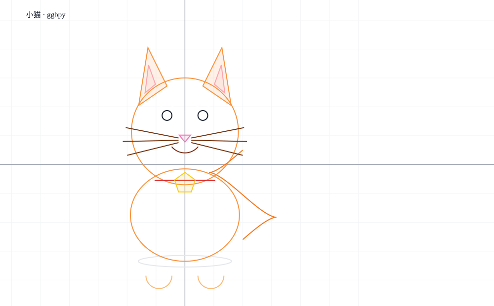
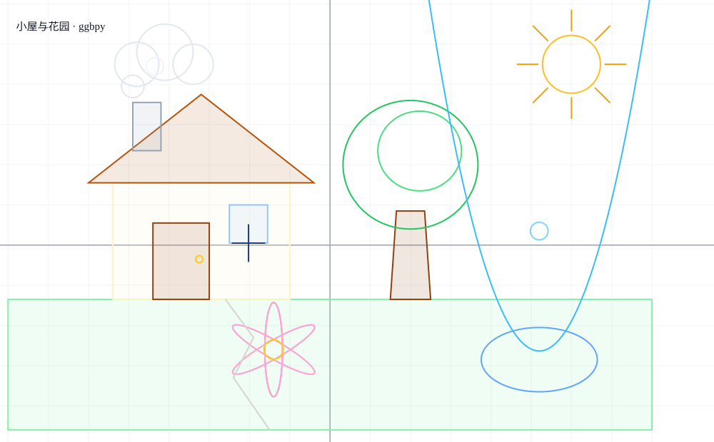
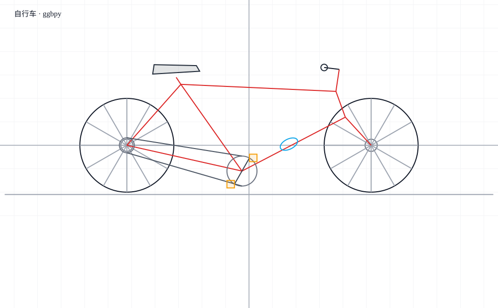
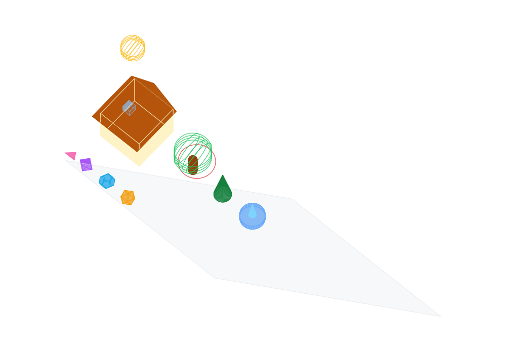

# ggbpy · Python 动态几何教学软件

> 用 Python 从头实现的「动态几何 + 代数 + CAS + 3D + 定理证明」一体化教学平台
> （GeoGebra 启发的交互理念，代码完全原创，BSD-3-Clause）。

`Python 3.12` · `FastAPI` · 原生 HTML5 Canvas（零构建）· **190 条命令** · 检测 **11/11 全绿（1923 断言）**

---

## ✨ 项目简介

ggbpy 是一个**浏览器端使用、Python 后端驱动的动态几何软件**：几何对象以**依赖图（DAG）**组织，拖动自由点即沿图拓扑序**增量重算**全部派生对象，符号计算底座为 **SymPy**。前端为原生 HTML5 Canvas（零框架），支持中英双语、明暗主题与移动端触控。

数学内核与 Web 服务分离（平台无关的 Python 包 + FastAPI），既可作为教学演示工具，也可作为"Python 动态几何"的参考实现来阅读与扩展。

## 🚀 快速开始

```bash
cd ggbpy
pip install -r requirements.txt      # fastapi / uvicorn / sympy / numpy
./run.sh                              # 默认端口 8090；可 PORT=8091 ./run.sh
```

浏览器打开 <http://127.0.0.1:8090> 即可使用（也可不用脚本：`python3 server/main.py --port 8090`）。

**上手三步**：

```text
A=(1,1)          # 点（可直接在画布上拖动）
B=(5,2)
s=Segment[A,B]   # 线段（随 A/B 自动重算）
M=Midpoint[A,B]  # 中点
```

拖 A 或 B，线段与中点会**实时跟随**；`?` 按钮打开命令帮助，输入框有签名补全（Tab / Shift+Tab 跳参数）。

## 🎯 功能总览

### 2D 动态几何

- **对象**：点 / 线段 / 射线 / 直线 / 圆 / 圆弧 / 扇形 / 多边形 / 刚性多边形 / 折线 / 向量 / 轨迹 / 文本
- **构造**：中点、垂线/垂足、平行线、中垂线、角平分线、切线（直线/圆/曲线/圆弧）、外接圆、内心/内切圆、垂心/外心/旁心、正多边形、圆上点/路径动点
- **圆锥曲线**：椭圆 / 双曲线 / 抛物线 / 五点圆锥曲线（圆/椭圆/双曲线自动参数化绘制，退化情形退回 marching squares）、焦点/准线、曲线求交
- **变换**：平移 / 旋转 / 镜像 / 位似 / 反演（圆反演，支持点、线、圆、线段、射线、圆弧、扇形、多边形、折线、向量、圆锥曲线、函数、参数/极坐标曲线、轨迹、隐式曲线等全部类型；其中线段/射线/圆弧/向量/参数/极坐标/椭圆**直接复合反演映射为参数方程**，曲线光滑）
- **度量**：距离 / 长度 / 斜率 / 角度（° 与弧度 π 分数）/ 面积 / 周长 / 半径 / 直径 / 半周长；**长度（`Length`，别名「弧长」）支持 线段 / 向量 / 折线 / 圆弧 / 扇形（取弧长）/ 圆 / 椭圆 / 列表（元素个数）**；**面积（`Area`）支持 多边形 / 圆 / 椭圆 / 扇形（½r²θ）/ 3D 立体 / 函数+上下限**；**周长（`Perimeter`）只对封闭图形有意义**：多边形（含刚性）/ 圆 / 椭圆 / 扇形 / 3D 截面 —— 圆弧/折线/线段是**开放曲线**，没有周长（明确报错并指向 `Length`）；工具栏「测量」的面积/周长工具与命令语义一致（周长只点封闭图形；**折线可点选/悬停**但不参与周长）；**中文命令/别名同样可用于嵌套写法**（如 `面积[扇形[A,B,O]]`、`周长[扇形[…]]`、`长度[弧[…]]`）（扇形周长 = 弧长 + 两条半径；椭圆用 Ramanujan 近似，圆退化为精确 2πr）
- **概率**：随机整数 / 随机点（圆内、多边形内）、排列组合、点积、相关系数 PMCC
- **刚性多边形**：两手柄语义 —— 拖首点平移、拖第二点绕首点旋转，边长恒定
- **二维剖分**：`Delaunay[点列表|多边形|点…]`（scipy Qhull）· `Voronoi[点列表|多边形|点…]`（不依赖 scipy，半平面裁剪 → 元胞均为**有界凸多边形**）；返回**多边形列表**，每个多边形带面积与质心，画布在质心标注面积、对象列表摘要为 `{N 个多边形（顶点范围），总面积 A}`；中文别名 三角剖分 / 德劳内 / 泰森多边形 / 沃罗诺伊

### 代数 / 函数 / 表达式

- 自由点 `A=(1,2)`、数值 `r=3`、函数 `f(x)=x^2+2x`（SymPy 解析，可互相引用并自动重编译）
- `Derivative` / `Integral`（定/不定积分、原函数）、`Root` / `Extremum` / `Intersect`（函数求交）
- **裸语法输入**（Desmos 风格）：`x^2+y^2=1` 隐式方程、`(cos(t),sin(t))` 参数曲线、`r=2cos(θ)` 极坐标、`y~a*x+b` 回归拟合、`L=[1,2,3]` 列表
- **If 分段函数**、动态文本拼接、未定义变量自动生成滑块
- 列表运算：`Sum/Mean/Median/Mode/Variance/StDev/Sort`、`Sequence`、`Iteration/IterationList`、`FitLine/FitPoly/FitExp/FitLog/FitPow/FitSin`
- **`NormalDist`** 正态密度；`StemPlot` 茎叶图等 8 类统计图（见下）
- **表达式依赖化**：`A=(s,0)`、`n=s*2`、`Segment[(0,0),(s,2)]` 这类**引用已有元素**的写法自动成为**受控对象**（声明依赖、随滑块重算、不可直接拖动，且保留原始定义式 `.ggk` 重放后仍跟随）；纯常量 `A=(1,2)` 仍是自由可拖对象
- **CAS 算子接线为构造命令**（可直接参与 DAG、可命名、可引用、随依赖重算）：
  `Solve[方程, 变量?]` → 数值解列表（复数解退回文本、无解给空列表）· `NSolve[方程, 变量?]` → 实根数值列表 ·
  `Limit[表达式|函数, x0]` → 数值（∞/不存在明确报错）· `PartialFractions[表达式|函数, 变量?]` ·
  `Substitute[表达式|函数, 变量, 值]` · `SolveODE[微分方程]` → 通解文本 ·
  `IsFinite[数值|表达式]` → 布尔 · `SurfaceArea[立体|曲面]` → 表面积；
  中文别名：求解方程 / 数值解 / 极限 / 部分分式 / 代入 / 微分方程 / 是否有限 / 表面积

### 画布工具与交互

- **分类工具栏**（点 / 线 / 圆 / 多边形 / 圆锥曲线 / 变换 / 度量 / 计算 / 统计图 / 控件 / 3D，共 **11 个分类**，30+ 工具）：动态虚线预览、拉框多选、对象点击拾取、选中对象整体拖动（OOP 联动）；**工具选中后再点一次即取消**
- **网格智能吸附**：视图菜单「吸附」开关；关闭时按住 **Shift** 临时吸附（2D）；落点优先复用已有点，避免在格点处叠出重复点；**拖动已有点时同样吸附** —— 2D 用「吸附开关 or Shift」，**3D 用「吸附开关 or Ctrl」**（3D 里 Shift 已绑定「只改高度」，按住 Shift 竖直拖动时吸附的是 **z**）
- **坐标系保持干净**：网格 / 坐标轴开关只画线，**原点不画标记**；需要 `(0,0)` / `(0,0,0)` 时用吸附（网格吸附含原点）或直接按坐标输入
- **视图按钮（顶栏，即时生效）**：放大 / 缩小（各 ×1.3，以画布中心为锚点）/ 复位（回到启动视图）；滚轮缩放不受影响
- **全局快捷键（规范）**：统一 `Ctrl+Shift+<键>`（macOS 用 `Cmd+Shift+<键>`），只绑定**切换类**低频动作，不用单键：

  | 快捷键 | 动作 | 助记 |
  |---|---|---|
  | `Ctrl+Shift+G` | 网格显示 / 隐藏 | **G**rid |
  | `Ctrl+Shift+X` | 坐标轴显示 / 隐藏 | **X** 轴 |
  | `Ctrl+Shift+S` | 格点吸附开关（关着时仍可按住 Shift 临时吸附） | **S**nap |

  规范：只用浏览器未占用的字母（避开 `Ctrl+Shift+A/T/N/W/I/J/C/D/B/O/P/R/F/Delete` 等）；匹配用 `ev.code`（不受键盘布局影响）；动作复用菜单按钮的 `click` 处理器；新增快捷键须同时更新面板 `title`（中英）与检测断言。
- **滑块（动态参数主力）**：`Slider[最小值, 最大值, 步长?, (x,y)?, vertical?, px?]` 在画布上画成「轨道线段 + 可拖滑钮」，标注 min/max 与 `名称 = 当前值`
  - 拖**滑钮** = 改数值（按步长吸附）；拖**轨道** = 移动整条滑块 —— 命中按「到各自轨道的垂距」取最近者，同锚点并存横/竖滑块也不会抓错
  - **播放**：滑钮右侧 **▶ / ⏸**；顶栏 **▶ 全部播放 / ⏸ 全部暂停 / ⚙ 动画设置**（步间隔、方向 `up`/`down`/`bounce`，多滑块共用一个定时器 → 真正同步）
  - **就地改范围/步长**：对象列表滑块行的 **⚙**（或 `SetSlider[滑块, 最小, 最大, 步长?]`），当前值保留（越界夹紧、按新步长吸附）
  - **竖直滑块**：`Slider[…, vertical]` / `SetSliderVertical[滑块, true/false]`（min 在底、播放按钮在轨道底部）
  - **轨道长度按 px（屏幕恒定）**：`SetSliderLength[滑块, px]`（40–1200，默认 140）
  - 滑块定义与当前值分别保存：拖动/`SetValue` **不改写** `Slider[…]` 定义，当前值进 `.ggk` 的 `values` 字段
- **交互控件**：`Button["说明","命令1;命令2",(x,y)?]`（点击逐行执行脚本）· `CheckBox["说明", 目标,(x,y)?]`（切换目标显示）· `InputBox[目标,(x,y)?]`（改目标数值）；控件无自身状态（勾选/文本由绑定对象派生），与 `.ggk` 往返天然一致
- **就地编辑**：画布上**双击控件**改说明（按钮接着问脚本）；对象列表双击控件行同理；列表**定义式单元格**双击做行内定义编辑（Enter 提交 / Esc 取消）
- **命令栏**：下拉补全每项带**完整签名**；输入时前缀有匹配即列候选（≤5 条，↑/↓ 选择、Tab 填入、Esc 收起、可点击）；补全后进入**模板态**——自动选中第一个参数、提示行**加粗高亮当前参数位**、可选参数淡显斜体、末尾给出位序（如 `2/6`），**Tab / Shift+Tab 循环跳参、Enter 顺序跳到下一个参数**（到末参才提交）
- **示例合成图形**（`share/figures/`，可用 `python3 devtools/make_figures.py` 一键重建；也可在 **文件 → 示例** 里一键打开，3D 示例会自动切到 3D 视图）：
  - **小猫**（66 个元素）：圆 + 多边形（耳/鼻，`Reflect` 镜像）+ 椭圆（身体）+ 参数曲线（尾巴）+ 圆弧（嘴）+ 半圆（爪）+ 正五边形（铃铛）+ 线段（胡须）
  

  - **小屋与花园**（97 个元素）：多边形（墙/屋顶/门/烟囱/树干/草地）+ 正四边形（窗）+ 圆（太阳/云）+ 椭圆（树冠/水池/花瓣）+ **抛物线**（喷泉）+ `Rotate`（阳光/花瓣）+ `Dilate`（树冠亮面）+ 折线（小路）
  

  - **自行车**（79 个元素）：双圆圆轮 + `Rotate` 每 30° 复制辐条（每轮 12 根）+ 线段钻石车架（链支/座支/座管/下管/上管/头管/前叉）+ 正四边形脚踏（`Rotate` 180° 出另一只）+ 齿盘/飞轮/链条 + 椭圆水壶 + 鞍座多边形
  

  - **3D 小屋与庭院**（56 个元素，`?view3d=1` 正交投影导出）：立方体房身 + **三棱柱**双坡屋顶 + 圆柱（树干/水池）/圆锥（松树/水柱）/球（树冠/太阳）+ 平面地面 + **四种正多面体**（正四面体/正八面体/正十二面体/正二十面体）+ **平面×球求交**（红色空间圆，切面隐藏）
  

  - 每幅图同时产出 `.svg`（矢量）/ `.ggk`（可加载回画布继续编辑）/ `.png`（预览）

### CAS 符号计算（右侧面板）

- 命令面板 11 个按钮（点击插入模板、光标停在括号内）；`#N` 可点击引用前序单元；`a:=5` 创建数值、`f(x):=x^2` 创建函数（`:=` 结果可联动到绘图区）
- 命令：`Expand` `Factor` `Simplify` `Solve` `NSolve` `Limit` `Derivative` `Integral` `SolveODE` `PartialFractions` `Substitute`；帮助面板 `?` 中也有入口

### 统计与概率

- **统计图 8 类**（统一缩放策略：几何按**世界坐标**绘制，滚轮缩放时整图同步放大；字体与线宽保持屏幕固定）：`BarChart` / `Histogram` / `BoxPlot` / `PieChart` / `LineChart` / `ScatterPlot` / `DotPlot` / `StemPlot`
- 每张图是**可整体拖动的对象**（世界坐标 `offset`，随 `.ggk` 保存）；黎曼和条带（左/右/中/下/上/梯形）

### 3D 视图

- 三维点/线段/直线/平面/球/圆锥/圆柱/棱柱/棱锥 + **五种正多面体**（正方体/正四面体/正八面体/正二十面体/正十二面体，黄金比构造）；2D 图形按 z=0 同场显示
- **`Cube` 多种输入**：`Cube[A,B]` / `Cube[A,B,C]` / `Cube[线段]` / `Cube[线段, 点]` / `Cube[正方形多边形]`；立方体与多面体工具按钮同样支持
- **`Cone` 多种输入**：`Cone[圆, 高度]` / `Cone[顶点, 底面圆心, 半径]` / `Cone[顶点, 轴向量, 半顶角(度)]` / 经典 `Cone[A,B,C]`；工具按钮支持点圆→高度、点顶点→底心→半径等
- **`Cylinder` 多种输入**：`Cylinder[圆, 高度]` / `Cylinder[底面圆心, 顶面圆心, 半径]` / 经典 `Cylinder[A,B,C]`
- **曲面三类**：显式 `Surface[z=f(x,y), …]`、参数 `SurfaceParam[x(s,t), …]`、隐式 `ImplicitSurface[f(x,y,z)=0, …]`（marching tetrahedra）
- **视角与操作**：斜二测（默认，可自由旋转）/ 俯 / 前 / 右正交视图；右键旋转、滚轮缩放、空白拖动平移；点击 3D 对象直接拖动平移（Shift+拖动只改高度）、z 轴控制柄改高度
- **控制点提示**：自由点渲染为红色菱形（可拖动）、派生点为蓝色圆点，选中变橙色虚线光环
- **渲染**：画家算法排序、hidden-line 遮挡虚线、逐对象线框/实体切换、坐标轴刻度
- **度量与变换**：`Translate` 的 z 分量参与运算；`Rotate[三维点,…]` 绕「过中心、平行 z 轴」旋转；`Distance`/`Angle` 用真三维量（角度单位仍是度）；`Volume[立体]` 与 `Area[立体]`（球/锥/柱解析，多面体按闭合网格积分）
- **3D 求交**：面×面、直线/线段×面、平面×立体（**截面多边形**）、球×平面/球×球/球×空间圆、空间圆相关、立体×立体（凸交）、立体/球×直线/线段（多交点用第 3 参数取第 n 个）
- **3D 测量工具**：工具栏 3D 分类里的 **体积** / **表面积** —— 点一下立体（立方体/多面体/球/圆锥/圆柱）即在状态栏给出 `Volume` / `SurfaceArea` 结果（与命令能力一致；3D 工具白名单从 `TOOL_CATS` 的 3D 分类**自动派生**，新增 3D 工具不再需要改两处硬编码）
- **对象类型可读化**：`/api/state3d` 为每个 3D 对象附带 `solid` 字段（sphere/plane/cube/cone/cylinder/prism/pyramid/tetrahedron/octahedron/hexahedron/icosahedron/dodecahedron），列表显示「球/圆锥/圆柱/正十二面体」等

### 定理证明 / 脚本 / 导出 / 协作

- `AreParallel` / `ArePerpendicular` / `AreCollinear` / `AreConcyclic` / `AreCongruent` / `AreConcurrent` + `Prove`（Botana 坐标法 + SymPy 符号归约；区分「恒假（存在反例）」与「退化敏感」）
- 脚本命令：`SetCoords` / `SetValue` / `SetColor` / `SetVisible` / `SetLocked` / `SetWire` / `Rename` / `Redefine` / `Delete` / `SetCaption` / `SetScript` 等
- 自定义宏（Macro，GUI 点选输入/输出）、命令脚本面板（`.ggs` 批量执行）
- **保存/加载**：自有 `.ggk`（JSON，含视口/样式/宏/滑块当前值/导入网格），兼容 `.ggb` XML 导入导出
- **导出**：SVG、PNG、3D 网格 OBJ / STL / glTF。SVG 2D 侧**覆盖全部 28 种可绘制元素**（点/线/圆/圆弧/多边形/折线/向量/函数/圆锥曲线/参数曲线/极坐标/隐式/轨迹/角度/黎曼和/不等式/文本 + **统计图 7 类 + 交互控件 3 类**，与画布同一套几何、**`Image` 以 data URI 内嵌**）、多边形填充跟随元素颜色；SVG 3D 侧保留元素颜色并按面法向做明暗、覆盖网格面/球经纬线/平面/空间圆/截面/交线，可用 `?view3d=1&yaw=<弧度>&pitch=<弧度>` 指定机位（`pitch` 取负值为俯视，默认 −0.52）
- **导入**：OBJ / STL / glTF / GLB 网格、图片（选图片 → 点两个基点放置，拖第二基点缩放保持长宽比）
- 一键生成**试卷 HTML**（题目截图 + 题干/答案编辑，A4 打印即 PDF）；**短链接分享**

### 界面与多语言

- 中 / EN 一键切换（zh / en 各 **203 条**词条，键集合由检测锁定防漏翻）、明暗主题、移动端响应式 + 双指缩放、Retina 高清渲染
- 命令输入**所见即所得 LaTeX 预览**（KaTeX 本地托管）、虚拟数学键盘（含 π、e）、对象列表行内编辑

#### ⚠️ 限制与边界（由检测矩阵锁定当前行为）

#### 2D 限制

- **撤销/重做**：撤销栈上限 `UNDO_LIMIT = 200`（超出丢弃最早快照）；重做走计算记忆，不是重新求值
- **计算记忆**：派生元素按「定义式 + 依赖几何状态签名」缓存，条目 ≤ 96、规模 ≤ 约 60 万坐标（超限淘汰最久未用）；**随机类命令**显式不参与记忆；compute 闭包必须**返回完整 state**（命中记忆时只 `apply_state`、不再调用闭包）
- **嵌套命令**：参数里的 `Cmd[...]` 最多 **4 层**（超出明确报错）；嵌套产生的匿名辅助元素不进对象列表 / 撤销 / 序列化
- **符号求解边界**：`Root` / `Extremum` 需有效区间（上限 > 下限）；`SolveIneq` / `Implicit` 输入不合法时给明确错误；`Solve` 只返回实数解（复数解给文本、无解给空列表）
- **统计图边界**：柱/直方图最大柱高 `CHART_H = 3`、饼半径 `PIE_R = 3`（世界单位），基线取世界 `y = 0`；饼图须非负且总和为正、直方图须非空且数据有变化、折线图 x/y 须等长且非空
- **茎叶图**：`StemPlot` 只接受**非负有限**数据（叶单位固定为 1）
- **列表字面量**：含元素引用时声明依赖并随依赖重算（纯常量仍是静态快照）；支持点标签 `{A,B}`（自动为 point / point3d）与三维点；点标签与坐标混用、二维与三维混用都给明确报错；命令参数里的内联列表同样动态
- **角度语义**：`Angle[A,B,C]` = 从 BA 逆时针到 BC 的**有向角**，范围 **[0°, 360°)**（钝角/优角正确表示）；弧的圆心角即该角（0..2π）；三维点用真三维夹角（0..180°）
- **剖分边界**：`Delaunay` 至少 3 点、共线/重合报「点集退化」；`Voronoi` 至少 2 点、重合点报错，元胞用外扩 15% 包围盒裁剪（规避无界元胞，面积和 = 包围盒面积）；只接受二维点/多边形
- **文本与求解其它边界**：`NSolve` 在默认区间 `[-60, 60]` 内找实根；`Limit` 为 ∞/不存在时明确报错；`SolveODE` 只给通解文本（含 `c1`，暂不支持初值条件）；`SurfaceArea` 只接受 3D 立体/曲面
- **`.ggk` / `.ggb`**：`.ggk` 为 JSON（样式/视口/宏/滑块值）；`.ggb` 按命令重放，网格与图片数据内嵌 `<ggbpyData>`（base64+JSON），仅当仓库缺数据时才跳过并给 `X-GGB-Warnings`
- **作图工具入口**：工具面板 **11 个分类**；统计图分类含 11 个按钮（2D 八类 + 3D 三类）
- **多语言词条**：zh / en 各 **203 条**，键集合完全一致（由检测锁定，防漏翻；主题 light/dark 记忆在 localStorage）
- **SVG 导出的图片**：`Image` 元素以 **data URI 内嵌**（导出文件自包含，不依赖服务端仓库）；若仓库记录缺失则画灰色虚线占位框（不会静默消失）；元素类型覆盖由检测白名单锁定，新类型漏画会直接红灯
- **周长（`Perimeter`）边界**：**只有封闭区域才有周长** —— 多边形（含刚性）/ 圆 / 椭圆 / 扇形 / 3D 截面；**圆弧/折线/线段是开放曲线 → 明确报错并提示用 `Length`**（长度 ≠ 周长）；双曲线/抛物线无有限周长 → 明确报错（不会给静默 0）
- **长度（`Length`）边界**：多边形请用 `Perimeter`（`Length` 会明确报错指引）；双曲线/抛物线长度无定义 → 明确报错；扇形 `Length` 只取弧长，`Perimeter` 才是弧长 + 两条半径
- **面积（`Area`）边界**：圆弧无面积（会明确报错并提示用 `Sector` 创建扇形）；扇形面积 = ½r²θ（θ 与 Perimeter/Length 同一套角度语义）；3D 立体请用 `Volume`/`SurfaceArea`
- **有意为之的边界**：`Implicit` 需含 x、y 的方程；立体相关的体积/截面积等运算属 3D

#### 3D 限制

- **3D 求交边界**：支持面×面（交线）、直线/线段×面、平面×立体（截面）、球×平面、球×球、球×空间圆、空间圆×平面、空间圆×空间圆、空间圆×立体、球×立体（交线）、立体×立体（凸交）、立体×直线/线段、球×直线/线段；**球面×曲面、体×空间圆（作为曲线输出）尚未支持**，会明确报错；平行/重合平面、超出线段的交点、相切球面/球过立体顶点会产出元素并带 `error`
- **曲面精度**：`ImplicitSurface` 为 marching tetrahedra 线性插值近似（网格越细越准，粗网格面积误差约 0.1%–8%）；曲面网格用于显示/面积/导出，`Volume` 无定义（明确报错）
- **曲面 × 网格导入**：OBJ/STL 导入只保留几何（顶点去重、面索引重排），忽略材质/UV/法向/颜色；非闭合网格仍可显示/导出，但 `Volume` 结果无物理意义
- **`.ggb` 完全无损**：三维点带真实 z（`w="1"`），3D 派生对象按命令重放，网格与图片数据内嵌随文件往返
- **SVG 导出**：默认 2D 视图（函数/圆锥曲线/参数曲线/极坐标/隐式/轨迹齐全，多边形填充跟随元素颜色）；`?view3d=1` 输出 3D 场景正交投影（画家算法，超 4000 面按面积取前 N 面）
- **重计算不长时间独占**：隐式曲面 marching 循环内每 **~5 ms 协作让出**（`GGBPY_YIELD_MS`，0=关闭），避免其它会话轻请求长时间排队；跨会话阻塞压测见 `devtools/bench_blocking.py`

## 🧪 检测与质量

```bash
bash devtools/run_all_detection.sh      # 全量 11 步（提交前门禁；服务在 8090）
bash devtools/run_all_detection.sh http://127.0.0.1:8091   # 非默认端口：4 个依赖服务的步骤都会透传该 BASE
bash devtools/run_scope.sh quick        # 迭代用：按改动层跑最小范围（见下）
```

### 全量检测（11 步 / 1923 断言）

| 步骤 | 脚本 | 断言 | 覆盖 |
|---|---|---|---|
| 1 命令注册表一致性 | `test_registry.py` | 17 | 注册表/别名/显示名/结果类型/参数签名表 |
| 2 内容寻址仓库 | `test_stores.py` | 18 | 图片/网格仓库 |
| 3 统一容差 | `test_tolerance.py` | 20 | 零魔数扫描、前后端常量一致、防漏导入 |
| 4 模块边界 | `test_modules.py` | 336 | 内核拆分、薄包装、前端作用域/文案外置/词条一致 |
| 5 多会话隔离 | `test_sessions.py` | 24 | `?sid=`/cookie、构造/宏/state3d 独立性、TTL |
| 6 2D 内核 | `test_2d_matrix.py` | 313 | 对象/命令/圆锥曲线/统计图/命名/`.ggk` 往返/计算记忆 |
| 7 2D 平台 API | `test_2d_api.py` | 121 | `/api/*`（state/input/drag/load/download/share/cas/image/export…） |
| 8 3D 三层 | `run_3d_detection.sh` | 503 / 183 / 156 | 3D 内核 / 3D API / 3D 浏览器 |
| 9 2D 前端回归 | `verify_2d_ui_matrix.js` | 204 | 编辑栏/CAS/工具/滑块/吸附/快捷键/指针捕获 |
| 10 微积分·求根 smoke | `test_mixed_smoke.py` | — | 2D↔3D 混合冒烟 |
| 11 代码质量策略 | `test_quality.py` | 28 | 宽泛捕获说明/预算、文档结构、CHANGELOG 批次完整性 |

### 分范围检测（迭代时用，避免每次等全量）

按「改了什么」挑最小范围（实测耗时，本机 8090 在跑）：

| scope | 覆盖 | 实测 |
|---|---|---|
| `docs` | 代码质量 / 文档与 CHANGELOG 结构守卫 | 0.3s |
| `registry` | 命令注册表 + 参数签名表 | 0.2s |
| `kernel2d` | 2D 内核矩阵 | 1.7s |
| `api2d` | 2D / 平台 API 矩阵 | 0.4s |
| `core` | 容差 + 模块边界 + 多会话隔离 | 1.6s |
| `content2d` | 内容寻址仓库 + 微积分 smoke | 0.2s |
| `kernel3d` / `api3d` | 3D 内核 / 3D API | 6.7s / 7.4s |
| `ui2d` / `ui3d` | 模块边界 + 浏览器矩阵 | ~100s / ~210s |
| `quick` | registry + kernel2d + core + docs | ~4s |
| `all` | 全量 11 步 | ~4–5 分钟 |

**策略**：迭代中按上表选最小范围；**提交前**纯文档改动跑 `docs`，**任何代码改动跑 `all`** 并看到「全部检测通过」。

### 开发纪律守卫

- `test_quality.py` F 段：**CHANGELOG 批次条目结构**（编号唯一 / 最新批次段连续 / 段长与总数不减少 / 条目够长），防止「整条被替换/删除」
- `devtools/doc_add_batch.py`：追加 CHANGELOG 批次条目的**唯一入口**（锚点行前插入 → 自检 → 结构守卫 → 不过自动回滚）
- `devtools/_probe_lib.js`（+ 自检）：浏览器探针夹具库（页面级清空 / 幂等选工具 / 按 alpha 量像素 / 世界→像素换算）
- 性能压测：`bench_blocking.py`（跨会话阻塞）、`bench_undo.py`（撤销/重做与快照成本）

## 🧱 架构

```text
ggbpy/
├── kernel/                平台无关内核（纯 Python，无 Web 依赖）
│   ├── elements.py        对象模型（GeoElement 家族 + 依赖/计算闭包）
│   ├── construction.py    Construction：注册表、DAG、增量重算、撤销/重做、序列化
│   ├── parser.py          代数输入解析（标签 / 元组 / 命令 / 数学表达式）
│   ├── registry.py        命令规格单一来源（COMMANDS / ALIASES / 显示名 / 结果类型）
│   ├── commands*.py       命令实现（2D / 3D / CAS / 统计 / 拟合 / 剖分…）
│   ├── tolerance.py       分级数值容差（零魔数）
│   ├── memo.py            计算记忆（撤销/重放加速）
│   ├── cas.py / prover.py SymPy CAS 引擎 / 定理证明器（Botana 坐标法）
│   └── ggb_io.py / svg_io.py    GGB XML / SVG 导出导入
├── server/
│   ├── main.py            FastAPI 服务（输入、拖拽重算、存取、分享、导出）
│   └── static/            前端（零构建）：index.html / app.js / style.css / i18n.js / data.js
├── devtools/              检测矩阵与工具（run_all_detection.sh / run_scope.sh / make_figures.py …）
├── share/figures/         示例图形（.svg / .ggk / .png）
├── run.sh                 一键启动（PORT 环境变量可改）
└── requirements.txt       Python 依赖
```

核心设计（沿用 GeoGebra 思想）：**对象挂在依赖图上 → 拖动自由点沿拓扑序增量重算**。每个对象由 `(deps, compute_fn)` 闭包描述，重算只影响受影响子树；编辑（重定义/重命名/改色）沿依赖链传播并保留样式，全部操作可撤销/重做（快照式）。

## 📖 命令示例

```text
A=(1,1)  B=(5,2)  C=(3,6)
M=Midpoint[A,C]
g=Line[A,B]
c=Circle[A,B]
poly=Polygon[A,B,C]
f(x)=x^2-2*x+1
df=Derivative[f]
area=Integral[f,0,4]
t=Tangent[f,2]
E=Ellipse[A,B,C]                                # 焦点 + 过点
c5=Conic[(0,0),(1,1),(2,0),(1,-1),(0.4,0.6)]    # 五点圆锥曲线
k1=Cone[Circle[(0,0),2], 3]                     # 底面圆 + 高度
k2=Cone[(0,0,5),(0,0,0),2]                      # 顶点 + 底面圆心 + 半径
k3=Cone[(0,0,0),(0,0,1),30]                     # 顶点 + 轴向量 + 半顶角(度)
y1=Cylinder[Circle[(0,0),2], 4]                 # 底面圆 + 高度
s=Slider[0,10,1,(-3,-4)]  f2(x)=s*x             # 滑块驱动函数
D=Delaunay[{A,B,C,(4,5),(7,2)}]                 # 三角剖分
Prove[AreParallel[g, Line[M,C]]]
```

中文别名（`中点` / `刚性多边形` / `外接圆` / `随机点` / `三角剖分` …）与全部 190 条命令见 **`?` 帮助面板**或 `GET /api/commands`。

## 📦 发布到 Gitee（如何上传本仓库）

### 第 1 步：在 Gitee 新建仓库

1. 登录 [gitee.com](https://gitee.com) → 右上角 **+** → **新建仓库**；
2. 填写仓库名（如 `ggbpy`）与简介；
3. **不要勾选**「初始化仓库」下的 README / .gitignore / 许可证（保持空仓库，避免推送冲突）；
4. 点 **创建**，复制仓库地址（HTTPS 形如 `https://gitee.com/<用户名>/ggbpy.git`；SSH 形如 `git@gitee.com:<用户名>/ggbpy.git`）。

### 第 2 步：本地初始化并提交

```bash
cd ggbpy
git init -b main
git add .
git status          # 核对将要上传的文件（.gitignore 命中的不会出现）
git commit -m "feat: ggbpy 动态几何教学平台首个版本"
```

首次使用 git 若提示身份缺失：`git config --global user.name "昵称"`、`git config --global user.email "邮箱"`。

### 第 3 步：关联远程仓库并推送

```bash
git remote add origin https://gitee.com/<用户名>/ggbpy.git   # 或 git@gitee.com:<用户名>/ggbpy.git
git push -u origin main
```

此后每次改动：`git add .` → `git commit -m "说明"` → `git push`。

### 第 4 步（可选）：SSH 免密

```bash
ssh-keygen -t ed25519 -C "你的邮箱"     # 一路回车
cat ~/.ssh/id_ed25519.pub               # 复制到 Gitee「设置 → SSH 公钥」
```

### 常见问题

| 现象 | 处理 |
|---|---|
| 推送被拒 `non-fast-forward` | `git pull --rebase origin main` 后再 `git push` |
| 认证失败 / 403 | HTTPS 用账号密码或**私人令牌**；确认用户名拼写 |
| 想上传的文件被忽略 | 检查 `.gitignore`；确实要传则 `git add -f <文件>` |
| 改 `.gitignore` 后仍被跟踪 | `git rm -r --cached <路径>` 再提交 |
| 想删除远程误传文件 | `git rm -r --cached <路径>` → commit → push（本地文件保留） |

> 进阶情况（多账号、已有远程仓库、Windows 换行符等）见 **`GITEE_UPLOAD.md`**。

## 📜 变更历史

本项目按「**批**」开发：每一批的功能、修复与检测数字都记录在 **[CHANGELOG.md](CHANGELOG.md)**（含各批次的检测断言数）。
本 README 只描述**当前状态**，不重复历史；需要查"某个功能是哪一批做的/为什么这么设计"请看 CHANGELOG。

## 📄 许可与致谢

- 本仓库代码为**原创**实现（BSD-3-Clause）。
- 设计交互思想参考 GeoGebra（EUPL 1.2，仅限非商用）；**不包含** GeoGebra 任何源码。
- 符号计算：SymPy（BSD）；Web 服务：FastAPI；数学渲染：KaTeX（MIT）。
