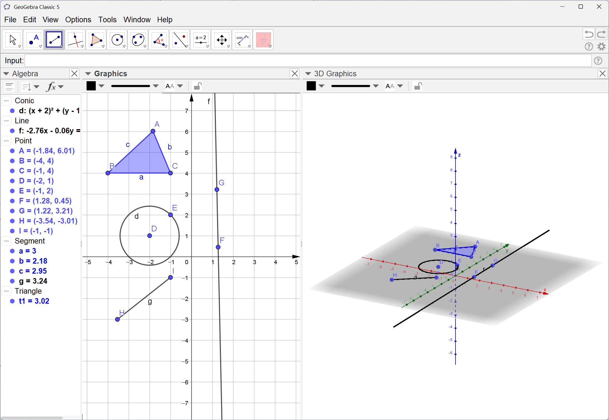

# ggbpy · Python 动态几何教学软件

> 用 Python 从头实现的「动态几何 + 代数 + CAS + 3D + 定理证明」一体化教学平台
> （GeoGebra 启发的交互理念，代码完全原创，BSD-3-Clause）。



## ✨ 项目简介

ggbpy 是一个**浏览器端使用、Python 后端驱动的动态几何软件**：几何对象以**依赖图（DAG）**组织，拖动自由点即沿图拓扑序**增量重算**全部派生对象，符号计算底座为 **SymPy**。前端为原生 HTML5 Canvas（零框架），支持中英双语、明暗主题与移动端触控。

数学内核与 Web 服务分离（平台无关的 Python 包 + FastAPI），既可作为教学演示工具，也可作为"Python 动态几何"的参考实现来阅读与扩展。

## 🚀 快速开始

```bash
cd ggbpy
pip install -r requirements.txt      # fastapi / uvicorn / sympy / numpy
./run.sh                              # 默认端口 8090；可 PORT=8091 ./run.sh
```

浏览器打开 <http://127.0.0.1:8090> 即可使用。

> 也可以不用脚本：`python3 server/main.py --port 8090`

## 🎯 功能总览

### 动态几何（对象 + 命令 + 画布工具）

- **对象**：点 / 线段 / 射线 / 直线 / 圆 / 圆弧 / 扇形 / 多边形 / 刚性多边形 / 折线 / 向量 / 轨迹 / 文本
- **构造**：中点、垂线/垂足、平行线、中垂线、角平分线、切线（直线/圆/曲线/圆弧）、外接圆、内心/内切圆、垂心/外心/旁心、正多边形、圆上点/路径动点
- **圆锥曲线**：椭圆 / 双曲线 / 抛物线 / **五点圆锥曲线**（动态预览，圆/椭圆/双曲线自动参数化绘制，退化情形自动退回 marching squares）、焦点/准线、曲线求交
- **变换**：平移 / 旋转 / 镜像 / 位似 / **反演（圆反演）**（支持点、线、圆、线段、射线、圆弧、扇形、多边形、折线、向量、圆锥曲线、函数、参数/极坐标曲线、轨迹、隐式曲线等全部类型；其中线段/射线/圆弧/向量/参数/极坐标/椭圆**直接复合反演映射为参数方程**，曲线光滑）
- **度量**：距离 / 长度 / 斜率 / 角度（° 与弧度 π 分数）/ 面积 / 周长 / 半径 / 直径 / 半周长
- **概率**：随机整数/随机点（圆内、多边形内）、排列组合、点积、相关系数 PMCC
- **画布工具**：分类工具栏（点/线/圆/多边形/圆锥曲线/变换/测量/计算/滑块/视图）30+ 工具，支持动态虚线预览、网格智能吸附、拉框多选、对象点击拾取、选中对象整体拖动（OOP 联动）
- **刚性多边形**：两手柄语义——拖首点平移、拖第二点绕首点旋转，边长恒定

### 代数 / 函数 / 可视化

- 自由点 `A=(1,2)`、数值 `r=3`、函数 `f(x)=x^2+2x`（SymPy 解析，可互相引用并自动重编译）
- `Derivative` / `Integral`（定/不定积分、原函数）、`Root` / `Extremum` / `Intersect`（函数求交）
- **裸语法输入**（Desmos 风格）：`x^2+y^2=1` 隐式方程、`(cos(t),sin(t))` 参数曲线、`r=2cos(θ)` 极坐标、`y~a*x+b` 回归拟合、`L=[1,2,3]` 列表
- **If 分段函数**、动态文本拼接、未定义变量自动生成滑块、滑块 ▶ 播放动画
- 列表运算：`Sum/Mean/Median/Mode/Variance/StDev/Sort`、`Sequence`、`Iteration/IterationList`

### CAS 符号计算（右侧面板）
- CAS 面板内置**命令面板**（11 个命令按钮，点击插入模板、光标自动停在括号内）；`#N` 可点击引用前序单元；`a:=5` 创建数值、`f(x):=x^2` 创建函数（结果可 `:=` 联动到绘图区）；命令：`Expand` `Factor` `Simplify` `Solve` `NSolve` `Limit` `Derivative` `Integral` `SolveODE` `PartialFractions` `Substitute`；帮助面板 `?` 中也有入口

### 统计 / 概率

- 直方图 / 分组直方图 / 饼图 / 箱线图（五数概括）/ 黎曼和条带（左/右/中/下/上/梯形）
- 正态分布密度 `NormalDist`、`FitLine/FitPoly/FitExp/FitLog/FitPow/FitSin`、散点列表

### 3D 视图

- 三维点/线段/直线/平面/球/圆锥/圆柱/棱柱/棱锥 + **五种正多面体**（正方体/正四面体/正八面体/正二十面体/正十二面体，黄金比构造）；2D 图形按 z=0 同场显示
- **`Cube` 多种输入**：`Cube[A,B]`（两点）、`Cube[A,B,C]`（三点定底面）、`Cube[线段]`（以线段为棱，方向缺省时系统自选）、`Cube[线段, 点]`（该点定相邻棱方向）、`Cube[正方形多边形]`（以正方形为底面），均为 8 顶点/6 面/12 棱等长；**3D「立方体」工具按钮**同样支持：直接点线段/正方形即生成，或点两个空间点自动生成
- **`Cone` 多种输入**：`Cone[圆, 高度]`（圆为底面，顶点在圆心正上方，高度可为滑块/数值）、`Cone[顶点, 底面圆心, 半径]`（轴可任意方向）、`Cone[顶点, 轴向量, 半顶角(度)]`（无限双圆锥，半顶角∈(0°,90°)）、以及经典 `Cone[A,B,C]`（A=底面圆心、B=半径点、C=顶点，底面垂直于 AC）；**3D「圆锥」工具按钮**支持：点圆/圆弧→输入高度，或点顶点→底面圆心→输入半径（对话框取消则改为再点一个底面半径点），或依次点顶点、底面圆心、半径点
- **`Cylinder` 多种输入**：`Cylinder[圆, 高度]`（圆为底面，沿圆法向抬升，高度可为滑块/数值）、`Cylinder[底面圆心, 顶面圆心, 半径]`（轴可任意方向），以及经典 `Cylinder[A,B,C]`（A=底面圆心、B=底面半径点、C=顶面圆心）；**3D「圆柱」工具按钮**支持：点圆→输入高度，或点底面圆心→顶面圆心→输入半径（对话框取消则改为再点一个底面半径点），或依次点底心、顶心、半径点
- 斜二测画法（默认，可自由旋转）/ 俯 / 前 / 右正交视图；右键旋转、Shift+拖动改 z、z 轴控制柄
- **3D 对象平移**：点击选中 3D 对象后直接在画布上拖动即可平移（普通=水平面内，Shift+拖动=仅改高度），空白处拖动仍旋转视角
- **3D 控制点提示**：自由点渲染为**红色菱形**（可拖动的控制点，拖动即可改变其驱动的立方体/多面体大小），派生点为蓝色圆点；选中的点变为**橙色**并加粗、带虚线光环，状态栏提示「已选中控制点 — 拖动可改变立体大小」
- 画家算法排序、hidden-line 遮挡虚线、逐对象线框/实体切换、坐标轴刻度
- **3D 度量与变换（2026-09-29 修正）**：`Translate[三维点,(dx,dy,dz)]` 的 z 分量参与运算；`Rotate[三维点,角度,中心]` 绕「过中心、平行 z 轴」的轴旋转、z 不变；`Distance[三维点,三维点]` 用真三维距离；`Angle[A,B,C]` 三点含 z 时用真三维夹角（**单位仍为度**，与 2D 一致；绘制的弧仍为 xy 投影示意）。纯 2D 对象行为不变
- **对象类型可读化**：`/api/state3d` 为每个 3D 对象附带 `solid` 字段（sphere/plane/cube/cone/cylinder/prism/pyramid/tetrahedron/octahedron/hexahedron/icosahedron/dodecahedron），3D 对象列表据此显示「球/圆锥/圆柱/正十二面体」等；`objtype` 保持历史值（多面体统一为 `polyhedron`）不变，旧脚本不受影响
- **嵌套命令参数（2026-09-29 新增）**：实参位置可以直接写命令调用，如 `Cone[Circle[O,2],3]`、`Cube[Polygon[(0,0,0),(2,0,0),(2,2,0),(0,2,0)]]`、`Sphere[O,Distance[A,B]]`、`Intersect[Plane[O,(1,0,0),(0,1,0)],Plane[O,(0,1,0),(0,0,1)]]`。内层命令**就地求值成匿名辅助对象**（不进对象列表 / 撤销快照 / 序列化），父对象保留你输入的原始定义，撤销重做与 .ggk/.ggb 往返都会重新求值；最多嵌套 4 层，内层失败会带原文报错（如「嵌套命令失败 Circle[O,-1]：半径必须大于 0」）
- **`Volume[立体]` 与 `Area[立体]`（2026-09-29 新增）**：`Volume[球/圆锥/圆柱]` 与 `Area[立体]` 走解析公式（精确），`Volume[棱柱/棱锥/立方体/五种正多面体]` 按闭合网格精确积分；中文别名 体积 / 表面积。示例：`V=Volume[Cylinder[c,4]]`、`A=Area[Sphere[O,2]]`、`Volume[Cone[Circle[O,2],3]]`。无限圆锥（`Cone[顶点,轴,半顶角]`）没有有限体积/表面积，会给出明确错误
- **网格规范化（2026-09-29）**：所有立体在构造出口统一为「面内正确环序 + 外向法向」（历史上面序/朝向不一致，例如立方体顶面是蝴蝶结序 `[4,6,7,5]`、二十面体 20 个面里 10 个朝内）——体积积分、遮挡判断与外部工具消费网格因此可靠；检测矩阵断言每个立体 Euler 特征数 `V-E+F=2`、面全部外向、多面体体积等于棱长解析式
- **3D 求交扩展（2026-09-29）**：新增 直线×平面 → 交点、平面×立体 → **截面多边形**（`objtype=section`，3D 视图橙色填充渲染，对象列表显示「截面」）、立体×直线/线段 → 交点（多交点用第 3 参数取第 n 个：`Intersect[cu,ln,2]`）、球×直线/线段 → 交点
- **第四批（2026-09-29）**：
  - **球×平面 → 空间圆**：`Intersect[Sphere[O,2], 平面]` 得 `objtype=circle3d`（圆心=球心在平面上的投影、半径 √(r²−d²)、带平面内正交基），3D 视图采样 64 点绘制，列表显示「空间圆」；相切（交线退化为点）与不相交都有明确错误
  - **立体×立体 → 凸多面体交**：`Intersect[立方体, 立方体]` 走半空间裁剪（对两个凸体的每个面平面依次裁剪 + 截面封盖），结果是与两者同构的 `polyhedron`，可直接接 `Volume`/`Area`；不相交或退化为面/点有明确错误，且 `V(A∩B) = V(B∩A)`
  - **`Perimeter[截面]`**：截面闭合环周长（如平面截立方体得正方形 → 8）
  - **求交退化容差**：线段端点恰在曲面/平面上（t=0 或 t=1）也算命中；球与直线相切（判别式≈0）只算一个交点；整段落在立体内部的线段提示「无交点（整段在立体内部或外部）」；平面与立体某面重合时截面仍正确（曾漏算）
- **第五批（2026-09-29）**：
  - **球×球 → 交圆**：`Intersect[两球]` 得空间圆（交平面垂直于连心线，半径 `√(r₁²−a²)`）；相离、内含、同心、相切都有明确错误
  - **空间圆×平面 → 交点**：`Intersect[空间圆, 平面]` 解析求解（`A cos t + B sin t = −E`），0/1/2 个交点，可用第 3 参数取第 n 个；圆与平面共面（整圆）、平行、相离都有明确错误
  - **空间圆×立体 → 交点**：沿圆周采样 + 二分细化求交（相切时用最近点兜底），多交点同样按第 3 参数取第 n 个；整圆在立体内部/外部给出明确提示
  - **样式持久化修复**：撤销/重做快照此前只存 `color`/`visible`，**`locked`（锁定）与 `wire`（线框）会在 undo/redo 后丢失**；现快照含全部样式（.ggk 往返早已保留），并有内层/API/浏览器三层断言守护
  - **退化网格**：`_normalize_mesh` 丢弃面积≈0 的退化面；薄板相交（体积 0.001 级）仍得有效凸多面体，面接触（零体积）明确报错
- **第六批（2026-09-29）**：
  - **3D 网格导出 OBJ / STL**：工具栏新增 **OBJ** 与 **STL** 按钮（也可直接访问 `/api/export/obj`、`/api/export/stl`）——OBJ 按对象分组（`o 标签`）并保留多边形面，STL 为 ASCII 三角面片（含单位面法向，按对象分 `solid` 块），可直接用于 3D 打印/外部工具；只导出网格体（立方体/多面体/圆锥/圆柱/棱柱/棱锥/正多面体/体交结果），跳过球/平面/截面等非闭合体并在响应头 `X-Mesh-Warnings` 给出提示
  - **球×空间圆 → 交点**：圆上点 `P(t)=C+r(cos t·u+sin t·v)` 代入球方程解析求解，0/1/2 个交点，`Intersect[球,圆,2]` 取第 2 个；圆整条在球面上（无穷多）与不相交分别报错
  - **空间圆×空间圆 → 交点**：共面走解析解（经典两圆），异面走「圆2 与平面1 交界 → 验证到圆心距」解析路径（**修掉共球面/同轴时判别函数恒 0 导致漏判**）；平行异面平面、重合圆（无穷多）、不相交都有明确错误
  - **健壮性**：把"自身处于 error 状态的元素"当求交参数时，给出「求交参数无效：…」而不是内部 KeyError
- **第七批（2026-09-29）**：
  - **`Surface[z=f(x,y), xmin, xmax, ymin, ymax, 网格数?]` 显式曲面**：生成 (n+1)² 网格（默认 24×24，上限 96），复用网格渲染/遮挡/导出链路（`solid="surface"`）；表达式可引用**滑块**并在拖动时重算；`Area[曲面]` 求曲面面积（如 `z=x` 的斜面 = √2），`Volume[曲面]` 明确报「曲面没有体积」；网格点取值非有限（奇点）或范围退化都有明确错误；曲面可直接参与 `Intersect`（如与平面求截线）
  - **三维点列表与 `FitPlane`**：列表语法支持三分量元组 `{(0,0,0),(1,0,0),(0,1,1)}`（`itemkind=point3d`，取值 `L(1)` 得带 z 的三维点）；`FitPlane[点列表]` 用协方差最小特征向量做最小二乘拟合平面（返回可继续参与求交/截面的 `plane` 元素）；点云共线（秩 1）或重合会明确报错
  - **OBJ 导入**：工具条新增 **📥 OBJ** 按钮（`/api/mesh` + `Mesh[网格id]`），导入的网格存进网格仓库并随 **.ggk 保存/加载**（与图片仓库同机制），可直接接 `Volume`/`Area`/`Intersect`/OBJ·STL 再导出
- **第八批（2026-09-29）**：
  - **参数曲面 `SurfaceParam[x(s,t), y(s,t), z(s,t), s, t, smin, smax, tmin, tmax, 网格数?]`**：任意双参数曲面网格（默认 24×24），表达式可引用滑块；示例：环面 `SurfaceParam[(2+cos(s))*cos(t),(2+cos(s))*sin(t),sin(s),s,t,0,2*pi,0,2*pi,32]`（面积 78.51 vs 解析 4π²Rr=78.96，误差 0.56%）、圆柱面、螺旋面；参数范围退化/参数名相同/奇点都有明确错误
  - **隐式曲面 `ImplicitSurface[f(x,y,z)=0, xmin, xmax, ymin, ymax, zmin, zmax, 分辨率?]`**：**marching tetrahedra** 抽取等值面（立方体按 Kuhn 分解成 6 个四面体，逐四面体插值三角化 + 法向朝 f 增大方向定向），输出三角网格可渲染/求面积/导出；示例：球面 `x^2+y^2+z^2-4=0`（面积误差 4.3%）、圆环 `(√(x²+y²)−2)²+z²−1=0`（误差 3.3%）；无等值面、取值非有限、范围退化都有明确错误
  - **STL 导入**：`📥 OBJ` 按钮现在同时支持 **OBJ / ASCII STL / 二进制 STL**（自动嗅探格式，二进制按 50 字节面记录解析），导入后同样是 `Mesh[网格id]` 元素并随 .ggk 持久化；实测导出→导入往返：立方体 STL 12 三角 → 网格 8/6/12、体积精确为 8
- **第九批（2026-09-29）**：
  - **3D 统计**：`Centroid[点列表]` 扩展为兼容多边形与点列表（三维点列表给出带 z 的质心，二维点列表给二维点，内联 `{(x,y,z),…}` 也可）；新增 **`FitSphere[点列表]`** 最小二乘球拟合（代数拟合，≥4 点；点云明显不共球时给出最大偏差并报错）；**`BoundingBox`** 点云包围盒与 **`Covariance`** 协方差矩阵见第十批
  - **球面×立体 → 交线**：`Intersect[球, 凸立体]` 返回 `objtype=curve3d` 的交线折线（按立体各面与球的交圆采样、保留落在体内者并按序连段），3D 视图渲染为橙色曲线；实测球心 (1,1,1) 半径 1.2 与立方体 [0,2]³ → 1074 段，所有点 **|到球心距离−r| < 1e-12** 且都在立方体表面；球在体内/包住立体/相切（过 8 顶点）都明确报错
  - **glTF 2.0 导出**：新增 **GLTF** 按钮与 `/api/export/gltf`（单文件 `.gltf`，POSITION/indices 内嵌 base64 buffer，含 min/max 包围盒），可直接导入 Blender/Three.js 等；导出字段与源网格逐项对齐（顶点总数、三角索引数 = 3×Σ(n−2)）
- **第十批（2026-09-29）**：
  - **点云统计**：`BoundingBox[点列表]` 轴对齐包围盒（8 顶点/6 面/12 棱，直接可求 `Volume`/`Area`，如 2×3×1 的盒子 → V=6、A=22；点云退化为一点时明确报错）；`Covariance[点列表]` 总体协方差矩阵（三维点列表 → 3×3、二维 → 2×2，可与 numpy 结果逐元素对齐）
  - **glTF / GLB 导入**：`📥 OBJ` 按钮现在支持 **OBJ / STL（ASCII·二进制）/ glTF / GLB** 自动嗅探——`.gltf` 读内嵌 data-URI buffer，`.glb` 按 12 字节头 + JSON 块 + BIN 块解析（含 componentType/byteStride 处理）；外部 buffer 的 `.gltf` 给出明确提示；**导出 → 导入往返逐项一致**（立方体+圆锥：57 顶点 / 106 三角完全吻合）
  - **大网格渲染预算**：面数 > 2000 的网格只绘制面积最大的 2000 个面（LOD，缓存面表），边数 > 4000 时跳过边线，并且当 `面数×边数 > 150000` 时跳过 O(边×面) 的 hidden-line 遮挡测试；实测 28³ 等值面（9288 面）**3 次重绘仅 8ms**（此前会卡死），仍有正常渲染输出
  - **修复：3D 模式下输入框创建对象后 3D 视图不刷新**（此前需切换视图或刷新页面才出现）——`submitInput` 以及撤销/重做/清空后现在都会同步刷新 3D 视图与对象列表
- **第十一批（2026-09-29）**：
  - **`.ggb` 支持 3D（长期限制解除）**：三维点现在按 `z="<真实z>" w="1"` 写出、导入时据此还原（`z="1"` 仍为二维齐次约定），3D 派生对象继续以 `<command>` 重放——实测三维点/球/立方体/圆锥/截面/线段/空间圆/交线/拟合平面/曲面**逐项往返一致且不再有跳过警告**；只有 OBJ/STL/glTF 导入的网格（数据在 .ggk 网格仓库里）仍会跳过并在 `X-GGB-Warnings` 说明
  - **`CovarianceEllipsoid[点列表, 倍数?]`**：协方差椭球（特征向量为轴、半轴 = k√λ，默认 k=2），输出可渲染/可导出的曲面网格；对称点云三轴相等、长条点云长轴 ∝ 标准差（与 numpy 特征值逐项一致）
  - **`SurfaceIsoline[曲面, 参数值, 维度?]`**：曲面参数线（固定 x / y / s / t），返回 `curve3d` 折线并在 3D 视图渲染；参数值超出定义域、隐式曲面（无解析参数）等情况给出明确提示
- **第十二批（2026-09-29）**：
  - **`ConvexHull[点列表]` 三维凸包**：scipy Qhull 求凸包（面统一环序与外向法向后输出可渲染/可求 `Volume`/`Area`/可导出的凸多面体）；立方体 8 点 → 8 顶点/12 三角（Euler=2）、V=8、A=24；共线/重合点云给出明确错误
  - **`SurfacePoint[曲面, u, v]`**：曲面在给定参数处的点（解析求值，越界报错）；**`SurfaceProject[点, 曲面]`**：点在曲面上的最近点（9×9 网格初值 + Nelder–Mead 精化，参数域内裁剪）——投影 (5,0,1) 到圆柱侧面得 (1,0,1)、(0,0,9) 到圆柱得端面 (0,0,2)
  - **命令帮助面板升级**：新增**筛选框**（按名称实时过滤）、命令 chip **点击即插入 `Name[]` 并把光标停在括号内**
- **第十三批（2026-09-29 · P0 性能与测试债）**：
  - **state3d 增量协议 + gzip**：`GET /api/state3d?since=<rev>` 返回三形态之一 —— `{rev, unchanged:true}`（零重传）/ `{rev, changed, removed}`（按 rev 差分）/ `{rev, elements}`（rev 过期全量兜底）；服务端只对实际发送的元素做 JSON 清洗，任意 `>1KB` 响应启用 gzip。实测：全量 **841 KB → 163 KB（19%）**；未变更刷新 **36 字节 / 6 ms**（优化前 56 ms）；单对象变更 **270 字节 / 6 ms**
  - **计算预算与串行化**：隐式曲面分辨率上限 64 → **48**，marching 循环内加**时间预算**（默认 8 s，`GGBPY_IMPLICIT_BUDGET` 可收紧，超时给「计算量过大」可操作错误）；`球×立体` 改 numpy 一次性半空间判定（76 面凸包 **3 ms**，原为 O(面数²) 纯 Python 循环），面数 > 4000 明确护栏；**共享构造的 11 个变更端点全部串行化**（并发写不再交错破坏 DAG）
  - **2D 回归入库**：新增 `devtools/test_2d_matrix.py`（**123 断言**，覆盖此前零引用的 60 条 2D 命令：变换/圆锥曲线/微积分/统计回归/线代复数/编辑/宏/布尔判定）与 `devtools/test_2d_api.py`（**31 断言**，覆盖此前未测的 17 个端点：drag/shift/batch/reorder/macro*/share+shared/image*/cas*/download/export-svg/demo/load）；统一入口 **`bash devtools/run_all_detection.sh`**
  - **写矩阵时揪出并修掉 6 个真 bug**：① `GeoFunction.compute()` 丢弃状态里的 `xsym` → **所有 `Fit*` 拟合函数不可求值、绘图样本全为 NaN**；② `Are*` 布尔判定对具体数值构造一律返回「未知」→ 增加数值兜底（含两线平行/重合的共点判定）；③ `Arc/Sector` 半径误取两端半径**平均** → 改为 `|CA|` 并要求圆心近似等距，否则明确报错；④ `BarChart[列表]` 只认 `[`（GeoGebra 列表用 `{}`）→ 三种写法全部支持；⑤ `SetColor` 拒绝带引号颜色 → 自动去引号；⑥ `FitExpr` 报错文案写成 `FitExp` 且未说明数据来源 → 修正；另抑制 `curve_fit` 警告噪音；`/api/commands` 现在附带规范**显示名映射**（`surfacepoint → SurfacePoint`、`implicitSurface → ImplicitSurface`、`fitplane → FitPlane` 等 54 个多词命令），帮助面板与输入框补全都用规范写法
- **第十四批（2026-09-29 · P1：性能结构债）**：
  - **撤销/重做计算记忆（`kernel/memo.py`）**：派生元素按「defn + 各依赖的几何状态签名」缓存计算结果，快照回放时依赖未变即复用 —— 含 n=32 等值面的构造 **redo 1201 ms → <1 ms**，且网格/依赖结果与撤销前逐项一致；依赖（滑块值、点坐标、网格规模…）任一变化或 defn 变化自动失效；随机类命令（RandomPointIn 等）显式**不参与**记忆，保证每次重算都会重新随机；条目数 + 规模双上限防内存膨胀
  - **3D 渲染投影复用 + 遮挡 bbox 预筛**：网格顶点在面/边之间只投影一次（大网格实测 reuse >1000 次，总投影次数从 ~8000 降到 ~4200）；遮挡测试改为「面屏外接矩形预筛 + 按深度近→远早停」，实测同一场景精确多边形测试 **321 → 9（36×）**，渲染结果不变（`projCalls` 一致）
  - **命令注册表单一来源 + 漂移守卫**：结果类型表从 `_result_kind()` 内部提为模块级 **`RESULT_KINDS`**（补上 5 条缺失：`circumcircle/pointonpath/macro*`），规范化 13 条多词命令的 CamelCase 显示名（`PerpendicularBisector`、`MacroCreate`、`PointOnPath`、`SemiCircle`…），并新增 **`devtools/test_registry.py`**：校验 163 条命令都有结果类型、别名都指向真实命令、别名与命令名不冲突、多词命令显示名规范、显示名唯一 —— 四张表以后再漂移会直接测出来
  - **2D 前端回归入库（`devtools/verify_2d_ui_matrix.js`，30 断言）**：覆盖此前无回归的前端路径 —— **编辑栏**（改色 swatch、显隐勾选、锁定勾选、重定义、改名、级联删除，并锁定"重定义必须同名"的守卫）、**撤销/重做/清空按钮**、**CAS 面板**（执行 `Expand[(x+1)^2]` 并校验结果）、**分享按钮**、**图片插入**（选文件 → 两次基点点击 → `Image` 元素）、**导出下载**（SVG/PNG/.ggk 三种文件）、**2D 工具点击建点**、**语言/主题切换**与"全流程无未捕获 JS 错误"  - **2D 前端回归入库（`devtools/verify_2d_ui_matrix.js`，32 断言）**：覆盖此前无回归的前端路径 —— **编辑栏**（改色 swatch、显隐勾选、锁定勾选、重定义、改名、级联删除，并锁定"重定义必须同名"的守卫）、**撤销/重做/清空按钮**、**CAS 面板**（执行 `Expand[(x+1)^2]` 并校验结果）、**分享按钮**、**图片插入**（选文件 → 两次基点点击 → `Image` 元素）、**导出下载**（SVG/PNG/.ggk 三种文件）、**2D 工具点击建点**、**语言/主题切换**与"全流程无未捕获 JS 错误"
- **第十六批（2026-09-29 · P2）**：
  - **`.ggb` 内嵌网格/图片数据**：导出时把引用到的 `mesh_store`/`image_store` 数据打包进 `<ggbpyData meshes=… images=… encoding="base64+json" data="…">`，导入时在重放命令**之前**恢复仓库 —— OBJ/STL/glTF 导入的网格与 `Image` 图片都能随 `.ggb` 完整往返（实测网格 8/6、依赖 `Volume`=8、图片可再次取图），不再产生跳过警告；仅当仓库数据缺失时才跳过并提示（防御路径）
  - **SVG 3D 投影导出**：新增 `GET /api/export/svg?view3d=1` 与工具条 **SVG·3D** 按钮 —— 固定视角（yaw/pitch）正交投影 + 画家算法，输出网格面多边形、球经纬线、平面、交线折线与点标签；按场景包围盒自动取景；`face_budget`（默认 4000）按面积取前 N 面防爆；无 3D 对象时返回 HTTP 400 与明确说明
  - **图片工具极速点击加固**：0ms 的 down→up 快击此前会因元素列表未及时合并而 `resetTool()` 丢掉待插入图片；现在图片工具在该分支保留 `pendingImage`，并加回归断言（0ms 两次点击仍能插入图片）  - **图片工具极速点击加固**：0ms 的 down→up 快击此前会因元素列表未及时合并而 `resetTool()` 丢掉待插入图片；现在图片工具在该分支保留 `pendingImage`，并加回归断言（0ms 两次点击仍能插入图片）
- **第十七批（2026-10-02 · P2 结构债）**：
  - **多会话隔离**（`server/sessions.py`）：每个会话拥有独立的构造 / CAS / state3d rev 历史 / 变更锁 / **宏表**；会话 id 解析顺序 `?sid=` > cookie `ggbpy_sid` > `default`；`server/main.py` 里的 `cons`/`cas`/`_SD` 改为**按当前请求解析的代理**，端点代码零改动；会话有上限（24）与 TTL（6h，超限淘汰最久未用，`default` 永不淘汰）；新增 `GET /api/session`、`POST /api/session/sweep`。浏览器端首次访问生成随机 sid 并写入 cookie —— **不同浏览器/上下文天然隔离**，会话内宏不跨用户泄漏；无 cookie 的脚本请求仍落到 `default` 会话（既有 API/脚本用法不变）
  - **内容寻址仓库统一**（`kernel/blob_store.py`）：图片仓库与网格仓库共用的「内容哈希 → 短 id / serialize / load」逻辑抽到通用模块，两者只保留各自领域规则（图片 data URL 校验、网格顶点去重与面索引重排）；公开 API 不变（`put/get/decode/edges_of/serialize/load`），坏记录逐条跳过并返回写入条数
  - 新增 `devtools/test_stores.py`（18 断言）与 `devtools/test_sessions.py`（23 断言，含会话上限/TTL 单元级验证）；2D 前端矩阵补「cookie 会话持久 + 新上下文独立」4 断言  - 新增 `devtools/test_stores.py`（18 断言）与 `devtools/test_sessions.py`（23 断言，含会话上限/TTL 单元级验证）；2D 前端矩阵补「cookie 会话持久 + 新上下文独立」4 断言
- **第十八批（2026-10-02 · P2 内核/前端拆分）**：
  - **内核拆分（`commands.py` 7,867 → 6,567 行）**：3D 几何算法抽为 **`kernel/geometry3d.py`**（33 个函数 / 849 行：网格规范化与体积面积、凸多面体半空间裁剪、面×面/线×面/平面×立体/球×平面·球·空间圆·立体·直线/立体×直线/立体×立体 等全部求交、空间圆基向量、射线-三角形、`_poly_state`）；立体构造数学抽为 **`kernel/solids.py`**（28 个函数 / 564 行：立方体三种构造、正四/六/八/十二/二十面体、棱柱/棱锥、圆锥/圆柱、球、正交基与解析元数据标注）。两者**只依赖 `elements`/`math`/`numpy`，不依赖命令层**，可独立导入与单测；`commands.py` 通过 re-export 保持全部调用方（含既有测试的 `from kernel.commands import _mesh_volume`）零改动
  - **前端文案外置（`app.js` 5,680 → 5,537 行）**：186×2 条 zh/en 文案抽到 **`static/i18n.js`**（由 `index.html` 在 `app.js` 之前加载，`app.js` 读 `window.GGB_I18N`，缺文件时退化为显示原始 key）——改文案不再动逻辑代码
  - **模块边界守卫（`devtools/test_modules.py`，25 断言）**：断言 `geometry3d`/`solids` 不 import 命令层、re-export 与源模块**同一函数对象**、新进程可独立导入（不拉起命令层）、规模预算，以及**静态防漏检查**（模块内调用的函数与引用的模块级常量必须已定义/导入 —— 本轮正是靠它抓到搬迁时漏掉的 `_poly_state` 与 `_PHI`）；前端侧校验 `i18n.js` 已加载、数据不再残留在 `app.js`、**中英词条键集合完全一致（186/186，无漏翻）**  - **模块边界守卫（`devtools/test_modules.py`，33 断言）**：断言 `geometry3d`/`solids` 不 import 命令层、re-export 与源模块**同一函数对象**、新进程可独立导入（不拉起命令层）、规模预算，以及**静态防漏检查**（模块内调用的函数与引用的模块级常量必须已定义/导入 —— 本轮正是靠它抓到搬迁时漏掉的 `_poly_state` 与 `_PHI`）；前端侧校验 `i18n.js` 已加载、数据不再残留在 `app.js`、**中英词条键集合完全一致（186/186，无漏翻）**
- **第十九批（2026-10-02 · 统一容差 + 二维几何层拆分）**：
  - **统一数值容差（`kernel/tolerance.py`）**：把散落在 13 个内核模块里的 `1e-12`/`1e-9` 等「判定接近 0」的魔数（**264 处**）统一为分级具名常量 —— `EPSILON=1e-12`（判定等于 0：叉积/行列式/分母）、`TIGHT=1e-15`、`COORD=1e-9`（坐标/长度尺度）、`ZERO_SQ=1e-18`、`LOOSE=1e-7`（网格/半空间）、`COARSE=1e-6`（采样/取景）、`NEGLIGIBLE=1e-300`（分母守卫）、`ROOT_TOL=1e-10`、`OPT_XATOL/OPT_FATOL`（优化器）；**取值与原字面量一致，行为不变**；顺带废除了旧别名 `EPS`（`elements.py`/`geom_util.py` 各自的本地常量）
  - **前端同步**：`app.js` 顶部定义同名 `EPSILON/COORD/COARSE`（14 处替换），与内核分级一一对应
  - **新增 `devtools/test_tolerance.py`（20 断言）**：常量分级与顺序、**源码零魔数扫描**（kernel/ 与 server/ 的代码部分，跳过注释/文档串）、**扫描器自检**（植入字面量必须被抓到）、**每个模块的容差导入集合 == 实际使用集合**（防漏导入/多余导入）、**禁止旧别名 `EPS`**、前端常量与内核取值一致
  - **`kernel/geo2d.py`（16 函数 / 437 行）**：二维几何基元与变换算法层 —— 点/直线（一般式·法式）/函数/圆锥曲线参数化，平移·旋转·反射（点与直线、关于直线或点）·位似，以及统一的 `_transform_fn`；只依赖 `elements`/`tolerance`/`math`/`numpy`；`commands.py` **7,867 → 6,171 行（−22%）**  - **`kernel/geo2d.py`（16 函数 / 437 行）**：二维几何基元与变换算法层 —— 点/直线（一般式·法式）/函数/圆锥曲线参数化，平移·旋转·反射（点与直线、关于直线或点）·位似，以及统一的 `_transform_fn`；只依赖 `elements`/`tolerance`/`math`/`numpy`；`commands.py` **7,867 → 6,171 行（−22%）**
- **第四十批（2026-10-03 · render3d 第三步：遮挡判定显式参数化 + 首个前端单元测试）**：
  - **`static/occlusion3d.js`（64 行）**：把嵌在 `render3d` 内的遮挡逻辑改为**显式参数**模块 —— `pointInPoly2d(px,py,poly)`（纯函数）· `buildFacePolys(faces)`（屏外接矩形 + 平均深度，近→远排序，丢退化面）· `edgeOccluded(p1,p2,facePolys,proj3,onTest)`（包围盒粗筛 + 精确射线法 + 早停）；`render3d` 仅留 3 行适配（`facePolys` 构建 + 同名 `edgeOccluded` 薄包装）
  - **首个前端单元测试** `devtools/test_occlusion_module.js`（10 项）：点在多边形内/外、退化面丢弃、按深度排序、包围盒正确、近面遮挡、计数回调、中点落在面外不遮挡、边更近时早停
  - **app.js 5013 → 4981 行**（前端累计 **5979 → 4981**）；加载顺序 `… → proj3d → axes3d → occlusion3d → app`
  - **踩坑**：替换闭包块时只删了 `pointInPoly2d`，漏删**原 `edgeOccluded` 定义** → JS 后定义覆盖前者 → 运行时报 `pointInPoly2d is not defined`；已按“同名函数只应有一个定义”显式断言防复发
  - 检测：模块边界 259 → **264**
- **第三十九批（2026-10-03 · render3d 第二步：三维坐标轴绘制模块）**：
  - **`static/axes3d.js`（约 180 行）**：`drawAxes3d`（71 行）/`drawMiniAxes3d`/`arrowHead3`/`niceStep3d`/`saveAxisTicks3d` 外置为 `window.GGB_AX3.create(env)`；`app.js` 5130 → **5013 行**（前端累计 **5979 → 5013**）
  - **复用链清晰**：`axes3d` 通过注入拿到 `proj3d` 的 `proj3/line3` 与 `panels` 的 `fmtNum`（转发助手一律注入，不搬迁）；`axisTicks3d` 为对象，共享引用即可（`saveAxisTicks3d` 只写 localStorage）
  - 加载顺序：`i18n → data → keyboard → exam → panels → draw2d → charts → proj3d → axes3d → app`
  - 检测：模块边界 253 → **259**；3D 浏览器 142 全过
- **第三十八批（2026-10-03 · render3d 拆分第一步：三维投影/屏幕空间模块）**：
  - **`static/proj3d.js`（约 160 行）**：三维投影与屏幕空间判定（`proj3`/`camBasis3`/`line3`/`distToSeg`/`pointInPoly`/`pointInScreenPoly`/`snapAxis3d`/`wsegHit`/`wptIn`/`is3DEl`）外置为 `window.GGB_P3.create(env)`；`app.js` 5222 → **5130 行**（前端累计 5979 → 5130）
  - **工具补强（两处真实踩坑）**：① 写入识别支持**自增/自减**（`dbgProjCalls++` → `env.set('dbgProjCalls', env.get('dbgProjCalls') + 1)`，改写顺序必须是「先通用替换、再改写写入形态」，否则生成嵌套废码）；② 有写入的模块**自动注入** `set: _panelStateSet`（否则运行时报 `env.set is not a function`）
  - **模块职责链**：`panels`/`draw2d`/`charts`/`proj3d` 的状态全部经 `_panelStateGet/_panelStateSet` 注入，转发助手（`sxp`/`syp`/`fmtNum`）一律作为**注入助手**
  - 加载顺序：`i18n → data → keyboard → exam → panels → draw2d → charts → proj3d → app`
  - 检测：模块边界 247 → **253**
- **第三十七批（2026-10-03 · 前端统计图渲染外置）**：
  - **`static/charts.js`（约 260 行）**：六类二维统计图绘制与命中框（`drawBarChart`/`drawBoxPlot`/`drawPieChart`/`drawLineChart`/`drawScatterPlot`/`drawDotPlot` + `chartBoxes`/`chartOff`/`chartBoxPut`/`chartAt`/`usableCanvasRect`）外置为 `window.GGB_CHARTS.create(env)`；`sxp/syp` 作为 draw2d 的**注入助手**（不搬迁），`chartBoxes` 以对象引用共享（模块内做属性写入，无需 env.set）
  - **app.js 5394 → 5222 行**（前端累计 **5979 → 5222**，−757 行）；加载顺序 `i18n → data → keyboard → exam → panels → draw2d → charts → app`
  - **JS 守卫改为动态扫描** `static/*.js`（排除 app.js/data.js/i18n.js）→ 新模块自动纳入，现覆盖 5 个模块
  - 浏览器验证：统计图相关断言全过（五种图拖拽命中盒、饼图扇区、折线/散点/点图颜色、整图拖动位移=鼠标位移、撤销回退、悬停仅显名称）
  - 检测：模块边界 242 → **247**
- **第三十六批（2026-10-03 · 前端 draw2d 拆分 + JS 作用域守卫）**：
  - **`static/draw2d.js`（约 190 行）**：二维画布绘制基元（`drawGrid`/`strokeSeg`/`strokePoly`/`drawArrow`/`sxp`/`syp`/`wxp`/`wyp`/`niceStep`）外置为 `window.GGB_D2.create(env)`；`app.js` 5394 行（前端累计 5979 → 5394），加载顺序 `i18n → data → keyboard → exam → panels → draw2d → app`
  - **`devtools/extract_frontend_group.py`（常驻工具）**：前端函数组「耦合分析 → 生成模块 → 改 app.js/index.html」一键完成；与内核 `extract_group.py` 对应
  - **`devtools/check_frontend_modules.js`（JS 作用域守卫）**：逐函数解析作用域链，报出「未定义标识符」——**函数作用域级**（文件级抓不到漏注入）。本轮它被真实事故驱动：`var cssW = 0, cssH = 0, dpr = 1;` 的多声明让状态分析漏掉 `cssH` → `drawGrid` 运行时 ReferenceError 被 render 的 try/catch 吞掉 → 对象列表面板不刷新（浏览器矩阵只表现为超时）
  - **守卫自检**：变异测试（删掉 `drawGrid` 的 `cssH` 注入）必须被抓到，已纳入模块检测
  - **转发助手归属规则**：`fmtNum` 这类「转发型薄包装」属于其原模块，抽取时作为**注入助手**而非搬迁（否则 app.js 注入的 `fmtNum` 指向新模块 → 无限递归）
  - 检测：模块边界 236 → **242**
- **第三十五批（2026-10-03 · 前端 panels 拆分：17 函数面板层外置）**：
  - **`static/panels.js`（307 行）**：对象列表/三维列表/工具面板/分类条/编辑栏/CAS 单元/工具按钮态共 **17 个渲染函数**外置为 `window.GGB_PANELS.create(env)`；状态经 `env.get/env.set` 注入（**只有 `showCat` 写 `activeCat`**，其余 16 个状态只读），读用别名、被写变量全程走 env（避免快照过期）
  - **app.js 5679 → 5484 行**（本会话累计 **5745 → 5484**）；app.js 保留 17 个同名薄包装（调用点零改动），`_panelStateGet/_panelStateSet` 提供状态访问；加载顺序 `i18n → data → keyboard → exam → panels → app`
  - **耦合分析的价值兑现**：拆分前脚本已给出「17 函数/238 行、17 个状态、仅 1 处写入、无组外函数依赖」，因此本次几乎是机械替换；浏览器 2D（64）+ 3D（142）矩阵全过、无 JS 错误
  - **新增冒烟**：`devtools/test_panels_module.js`（空列表提示/对象行渲染/showCat 写 activeCat/嵌套翻译/转义）接入模块检测
  - 检测：模块边界 229 → **236**
- **第三十四批（2026-10-03 · 前端拆分起步：试卷模块外置 + 耦合面分析工具）**：
  - **`static/exam.js`（104 行）**：试卷渲染/导出（`renderExam`/`exportExam`/`escHtml`）外置为 `window.GGB_EXAM.create(env)`；**状态只读注入**（`exam`/`lang` 经 `env.getExam()/getLang()`，`t`/`setMsg` 由 env 注入），app.js 保留同名**薄包装**，调用点零改动；`app.js` 5745 → **5679 行**，加载顺序 `i18n → data → keyboard → exam → app`
  - **前端耦合面分析（自定义脚本）**：对 app.js 175 个函数做「闭包 + 状态变量耦合」分析，得出各组抽取成本 —— `exam` 组 6 函数/109 行（7 个状态）已拆；`panels` 组 17 函数/238 行（18 个状态：`elements/listEl/selected/…`）待拆，`draw2d` 组 8 函数/115 行（5 个状态）待拆
  - **经验**：JS 函数体边界不能用括号配平（正则字面量 `/[\\/:*?"<>|]/` 会打断扫描）→ 本仓库格式统一，用「缩进 2 的 `}` 行」定界最可靠；首次抽取曾把 `escHtml` 之后的**试卷面板装配代码**一起吞进模块，冒烟测试立刻暴露
  - **新增冒烟**：`devtools/test_exam_module.js`（桩 env：渲染非空/转义生效/导出提示），已接入模块检测
  - 检测：模块边界 222 → **229**
- **第三十三批（2026-10-03 · commands.py 收尾：嵌套求值器外置 + 导入块压缩）**：
  - **`kernel/nested.py`（92 行）**：嵌套命令求值器（`_DetachedConstruction` 影子构造 + `_eval_nested`）外置，导入即向 `cmd_util` 注入求值钩子；依赖 `registry`（命令表）/`cmd_util`/`parser`/`elements`，**不依赖 commands**，依赖方向清晰
  - **命名助手随注册表**：`_result_kind`/`_label_kind`（自动标签类型判定）移入 `registry.py`（与四张表同居一处，也解开 nested 对 commands 的依赖）
  - **re-export 导入块压缩**：24 处多行名单折成单行/自动换行（纯格式，语义不变），`commands.py` **1472 → 1156 行**（本会话拆分前 7867 → **−85%**）
  - `commands.py` 现在只剩：调度器（`process_line` 167 行 + 解析辅助）、少量共享助手（`_make_function`/`_complex_build`/`_number`/`_list_defn`/`_make_ineq_*`）、各命令组 re-export；顶层 def ≤ 14 个
  - 检测：模块边界 212 → **222**（nested 8 项 + 调度器规模 2 项）
- **第三十二批（2026-10-03 · 剩余命令抽净 + 注册表拆分，commands.py 退化为调度器）**：
  - **剩余 22 条命令抽成 6 组**：`proofs.py`（共点/共圆/全等/Prove）· `centers.py`（外心/垂心/旁心）· `fits.py`（指数/对数/多项式/幂/正弦拟合、PMCC、协方差椭球）· `iteration.py`（Iteration/IterationList/Locus）· `macros.py`（MacroCreate/MacroList）· `misc.py`（随机数/线框）
  - **`kernel/registry.py`（341 行）**：四张注册表集中一处（`COMMANDS` 169 / `ALIASES` 198 / `DISPLAY_NAMES` 73 / `RESULT_KINDS` 169），从 17 个命令组模块汇总实现；依赖方向 `命令组 → registry → 调度器`（新进程只导入 registry 不会拉起 commands，检测已断言）
  - **规模收益**：`commands.py` **2211 → 1576 行**（本会话拆分前 **7867 → −80%**），现仅剩调度器（`process_line`/`_eval_nested`/`_label_kind`/`_result_kind`）、少量共享助手与 re-export
  - 检测：模块边界 203 → **212**（registry 8 项 + 规模/入口）
- **第三十一批（2026-10-03 · 命令组续抽：圆锥曲线/线代复数/度量）**：
  - **新增 3 个模块**：`conics.py`（12 函数/275 行：椭圆/双曲线/抛物线/五点圆锥/焦点/直径/极线/隐式曲线/参数曲线）· `linalg.py`（16/150：矩阵/行列式/转置/逆/点积/复数 arg·conj·im·re）· `measures.py`（15/178：距离/长度/周长/半周长/半径/斜率/角度）
  - **规模收益**：`commands.py` **2698 → 2212 行**（本会话拆分前 7867 行 → **累计 −72%**），剩余为四张注册表 + 调度器 + 少量命令（宏/迭代/布尔证明/拟合/随机）
  - **工具随用随修**：`extract_group.py` 本轮又修三处 —— 导入按模块**合并去重**、同名符号**确定性取单一提供者**（避免 `prover`/`calculus` 同名 `_cmd_of` 冲突）、parser 符号**整体导入**（`_split_brace`/`tokenize` 等，此前只导入 `eval_number`）
  - 检测：模块边界 140 → **161**（3 组 ×5 项 + 规模/入口）
- **第三十批（2026-10-03 · 命令组全面抽出：图元/变换/编辑/数值/导入导出 + 抽取工具常驻）**：
  - **新增 5 个命令组模块**：`primitives.py`（77 函数/1232 行：点/线/圆/多边形/中点/垂足/内外心/切点/交点 + 谓词）· `transforms.py`（18/430：反射/旋转/平移/位似/反演）· `editing.py`（11/113：改值/改色/改名/重定义/删除/显隐 + `_COLOR_NAMES`）· `numeric.py`（19/140：求和/均值/方差/排序/四分位/组合数/取整）· `io_cmds.py`（7/145：图片与动态文本）
  - **规模收益**：`commands.py` **4593 → 2699 行**（本会话拆分前 7867 行 → **累计 −66%**）；剩余主要是注册表（COMMANDS/ALIASES/DISPLAY_NAMES/RESULT_KINDS）与调度器
  - **抽取工具常驻**（`devtools/extract_group.py`）：`--analyze` 按功能族列出剩余可搬命令组（含闭包规模与组外依赖），`--module/--seeds/--apply` 一键搬迁（AST 闭包 → 导入合成 → 删除 → re-export）；本轮用它完成 5 组搬迁
  - **工具与守卫的双向加固**：工具改为**动态扫描 kernel/ 模块**作提供者、**从模块源码**收集可提供符号（常量常未导出，如 `_REF_X`）、**模块级常量自动随迁**（如 `_PRED_VIEW`/`DEG`/`_COLOR_NAMES`）；守卫沿用 AST 级「调用名 + 属性基名必须可解析」
  - 检测：模块边界 103 → **140**（5 组 ×5 项 + 规模与入口）
- **第二十九批（2026-10-03 · 命令组继续抽出：统计图 + 三维）**：
  - **`kernel/charts.py`（11 函数 / 247 行）**：统计图命令组整体抽出（`BarChart`/`Histogram`/`BoxPlot`/`PieChart`/`LineChart`/`ScatterPlot`/`DotPlot`/`BarChart3D`/`ScatterPlot3D`/`SurfaceChart3D` + `_anon_list`）
  - **`kernel/commands3d.py`（40 函数 / 760 行）**：三维命令组整体抽出（立方体/球/圆锥/圆柱/棱柱/棱锥/正多面体/平面/曲面/参数曲面/隐式曲面/网格/体积/面积/截面/凸包/包围盒/协方差等）
  - **规模收益**：`commands.py` **5541 → 4594 行**（本会话拆分前 7867 行 → **累计 −42%**）；两组闭包均先确认**组外依赖为 0** 再搬，`cmd_util` 共享层是关键前提
  - **抽取流程工业化**：写了通用抽取脚本（AST 求闭包 → 生成模块 → 合成导入 → 删除原函数 → 加 re-export），并把守卫升到「**属性基名**也要可解析」（本轮抓到 `schemas.chart3d(...)` 这类模块属性访问漏导入）与「**任意缩进的 def/class 都算定义**」（修 `class _L` 误报）
  - 检测：模块边界 87 → **103**（charts 5 / commands3d 5 / 规模与入口 6）
- **第二十八批（2026-10-03 · 解开命令层循环依赖 + 微积分命令抽出）**：
  - **`kernel/cmd_util.py`（命令层共享工具，约 200 行）**：14 个参数解析/元素构造助手（`_resolve`/`_lookup`/`_list_arg`/`_point_arg`/`_mk`/`_auto`/`_num_deps`/`_num_series`/`label_of`…）+ 嵌套命令常量（`_NESTED_CALL_RE`/`_NESTED_MAX_DEPTH`）迁出；**用钩子解开循环依赖** —— `_lookup` 遇到嵌套命令时调用 `set_nested_evaluator()` 注入的 `commands._eval_nested`，本模块不依赖命令注册表
  - **`kernel/calculus.py`（22 函数 / 611 行）**：微积分与符号计算命令（Derivative/Integral/Root/Extremum/黎曼和/序列与数论/正态分布/SolveIneq/FitExpr 及解法格式化助手）整体抽出，只依赖 `elements`/`tolerance`/`parser`/`cmd_util`；`commands.py` 通过 re-export 与命令表继续引用
  - **规模收益**：`commands.py` **6250 → 5548 行**（−702，拆分前 7867 行 → 累计 −29%）
  - **守卫升级（AST 级）**：新增「抽出模块内所有 `name(...)` 调用必须已定义/导入/内建」检查（全树收集导入以兼容惰性导入）—— 本轮它先于人工发现漏导入风险，实际抓到 `eval_number`/`label_of`/`re` 三处漏项；同时把带类型注解的赋值识别为定义
  - 检测：模块边界 63 → **87**（cmd_util 10 / calculus 7 / AST 守卫 7）
- **第二十七批（2026-10-03 · 第十八批剩余拆分：结构收敛 + 前端面板）**：
  - **元素 data 载荷集中定义（`kernel/schemas.py`）**：REVIEW 指出 `data` 约定散落各处（内核二十余处内联 objtype 字典），现统一为具名 builder（`line3d`/`segment3d`/`plane`/`sphere`/`circle3d`/`section`/`curve3d`/`polyhedron`/`surface`/`cube`/`chart3d`，支持 `**extra` 追加 lo/hi、points、grid、expr、param、center、axes、ranges、fit 等键）；`commands.py`/`geometry3d.py`/`solids.py`/`stats.py` 共 **26 处**改为调用 builder，**键顺序与载荷完全不变**；`test_modules.py` 新增守卫：kernel 内再出现内联 objtype 字面量即失败
  - **前端数学键盘面板外置（`static/keyboard.js`）**：47 个按键的 HTML 仍在 `index.html`，行为抽为 `window.GGB_KB`（展开/收起、插入/退格/清空/Enter、目标输入框 `#cas-cmd` 优先）；`app.js` **5797 → 5745 行**，加载顺序 `i18n.js → data.js → keyboard.js → app.js`
  - **运行环境健壮性**：机器上 `python3` 可能指向无三方库的 venv（实测 3.15rc2 无 numpy/sympy，导致服务与检测直接失败）→ 新增 `devtools/_env.sh` 自动挑选**能 import numpy+sympy** 的解释器，`run.sh` 与两个检测 runner 均改用它并打印实际解释器版本
  - 检测：模块边界 50 → **63**，2D 前端 59 → **64**（键盘展开·插入·退格·清空·收起）
- **第二十五批（2026-10-02 · 统计图全家桶 + 可整体移动 + 三维统计图）**：
  - **新增 2D 图型**：`LineChart`（折线，支持单序列或 x/y 双序列）、`ScatterPlot`（散点，支持点列表/数值列表/x·y 双序列）、`DotPlot`（点图，相同值向上叠点）；与既有 `BarChart`/`Histogram`/`BoxPlot`/`PieChart` 共六类
  - **每张统计图都是一个可整体移动的对象**：元素新增世界坐标 `offset`（`GeoChart2D` 基类），前端绘制时整张图一起平移（柱/箱/扇区/折线/散点同步），**鼠标直接拖动整张图**即可在平面上移动，可撤销；`move(图, x, y)` 设偏移、`shift(图, dx, dy)` 累加；`.ggk` v4 保存 offset（旧文件兼容）
  - **新增三维统计图**：`BarChart3D`（每根柱一个长方体）、`ScatterPlot3D`（每个点一个八面体标记）、`SurfaceChart3D`（高度场网格）；走既有 `polyhedron/mesh` 渲染管线，随 3D 视图旋转/缩放/遮挡；统计图网格**非凸**，面序在构造时手工保证外向（不用 `_normalize_mesh` 的质心外向化）
  - **命名规则**：统计图使用可辨识前缀 `bc1`（条形/直方图）、`bp1`（箱线）、`pie1`（饼）、`lc1`（折线）、`sc1`（散点）、`dp1`（点图）、`bc3_1`/`sc3_1`/`sf3_1`（三维），不再落到默认字母池（此前饼图/箱线图会被命名成 `a`、`b`）
  - **修掉一个潜伏真 bug**：统计图的状态函数原是「改元素属性 + 返回 `{}`」，而**计算记忆命中时只回放返回值、不再调用函数** → 同一 `defn` 第二次创建时新元素数据为空（浏览器里实测 `lc.xs=0`、`pie.items=0`）。改为返回完整状态字典（`{xs,ys}` / `{pts}` / `{values,stacks}` / `{items,total}` / `{five,n}`），memo 回放正确
  - 检测：2D 内核 +29（167）、2D API +13（44）、2D 前端 +7（53）、3D 前端 +8（142）；覆盖命名/偏移/move·shift/锁定/`.ggk` 往返/三维网格欧拉与面序/拖动像素位移/悬停名称
  - **第二十六批（2026-10-02 · 统计图菜单入口 + 顶部工具栏下拉菜单）**：
  - **工具栏菜单入口（图形化，不必敲命令）**：新增「**统计图**」分类，含 10 个按钮 —— 直方图 / 直方图分组 / 箱线图 / 饼图 / **折线图 / 散点图 / 点图** / **三维柱状图 / 三维散点图 / 三维曲面图**；点按钮即弹出数据输入框（散点用 `1,2; 3,4`，三维点用 `1,2,3; 4,5,6`，曲面图再问列数），生成后自动命名 `bc1/bp1/pie1/lc1/sc1/dp1` 与 `bc3_1/sc3_1/sf3_1`；3D 统计图对象在对象列表里显示「三维柱状图/三维散点图/三维曲面图」（`solid.chart_*` 文案）
  - **顶部工具栏重排为下拉菜单**（用户要求「第一行按钮重新分类、导出/导入各自合并」）：第一行从 19 个平铺按钮收敛为 **5 个下拉菜单 + 5 个常驻按钮**（单行不再换行）——
    **📂 文件**（示例 / 保存 .ggk / 加载 .ggk·.ggb / 分享链接 / 清空画布）· **📤 导出**（SVG 2D / SVG·3D 投影 / PNG / OBJ / STL / glTF）· **📥 导入**（三维网格 OBJ·STL·glTF / 插入图片）· **👁 视图**（网格 / 坐标轴 / 吸附 / 角度单位 / 主题 / 语言）· **🧰 工具**（几何工具面板 / 选择 / 数学键盘 / CAS / 试卷 / 脚本 / 宏）；常驻：命令输入框、`?` 帮助、撤销、重做、3D 切换
    实现：`index.html` 只重排结构与保持**原按钮 id 不变**（JS 绑定、脚本与检测无需改动），`style.css` 加 `.menu/.menu-list` 样式，`app.js` 加菜单开合（点标题展开、点条目/空白/Esc 收起），i18n 加 `menu_*` 文案；浏览器矩阵新增 `clickBtn()` 助手（自动展开所在菜单后再点击）
- **第二十四批（2026-10-02 · 第十八批收尾：统计子模块 + 前端数据表外置）**：
  - **补齐第十八批（内核/前端拆分）尚未完成的范围**：新增 **`kernel/stats.py`**（8 函数 / 139 行：`_median`/`_mode`/`_variance`、`_fitline_state`/`_fit_silent_fit`、`_barchart_state`、`_fitsphere_state`/`_fitplane_state`）与随迁常量 `_REF_X`/`_REF_DOT`；只依赖 `math`/`re`/`tolerance`/`geo2d`，`commands.py` **6,192 → 6,086 行**
  - 前端新增 **`static/data.js`**（纯数据 102 行：`CAS_COMMANDS` 11 条 / `TOOLS` 工具定义 / `TOOL_CATS` 分类），`app.js` **5,631 → 5,542 行**；加载顺序 `i18n.js → data.js → app.js`，缺文件时退化为空表
  - 模块边界检测扩到 **50 断言**：stats 独立性/re-export 同一性/常量随迁/规模预算；data.js 存在与加载顺序、数据不再内联、**`TOOL_CATS` 与 `TOOLS` 双向一致性**（无悬空、无孤儿——孤儿工具必须有顶栏按钮，实测 `image` 属顶栏）
  - 已确认第十八批剩余未做的部分：**CAS 子模块**、**前端 renderer/panels 拆分**（`app.js` 仍混装渲染与面板逻辑，属大工程，建议单独开批）
- **第二十三批（2026-10-02 · 反演命名规则）**：
  - **问题**：`Invert` 在结果类型表里登记为 `point`，无标签时统一走「点」的字母池 → 反演出来的圆/直线/曲线/多边形被命名成 `A`、`B`…（而绝大多数反演像并不是点）
  - **新规则**：新增命名类型 `invert` —— **点反演仍用点命名（`A`,`B`,…）**，其余反演像统一用 **`inv1`, `inv2`, …小写前缀**（与既有前缀风格一致：`pl1` 折线 / `bc1` 条形图 / `tx1` 文本 / `lo1` 轨迹 / `mat1` 矩阵）；序号自动跳过已占用标签，显式标签 `q=Invert[…]` 不受影响，`.ggk` 往返保留 `inv*` 名
  - 实现：`kernel/construction.py` 名称池加 `invert`（前缀分支）；`kernel/commands.py` 新增 `_label_kind(cons, lname, args)`，仅对 `invert` 按**被反演对象的类型**动态决定命名（点→`point`，其余→`invert`），调度层与嵌套命令均走它
  - 检测：2D 内核矩阵 +14 断言（各类型命名/序号递增/冲突跳过/显式标签/引用/`.ggk` 往返），2D 前端矩阵 +2 断言（反演工具建图 → `inv1`；对点 → 单大写字母）
- **第二十批（2026-10-02 · 悬停提示修复）**：
  - **圆/圆弧悬停锚点取到了对侧**（真 bug）：`hitForTip` 里屏幕向量换算回世界坐标时 x、y 符号都反了，悬停圆的上方时提示锚点落到圆的下方 —— 视觉上就是「提示位置太低」。已改为落在圆上**离光标最近**的一点（4 个方向均有回归断言）
  - **提示框在画布边缘被裁掉**：原来固定在锚点右上方（`hx+10, hy-30`）绘制，靠近画布顶边/右边会显示不全；现在**默认右上方，放不下自动翻到另一侧并夹在画布内**，文本随框定位（原来是固定 `hy-15`，框一旦移动文本就会错位）  - **提示框在画布边缘被裁掉**：原来固定在锚点右上方（`hx+10, hy-30`）绘制，靠近画布顶边/右边会显示不全；现在**默认右上方，放不下自动翻到另一侧并夹在画布内**，文本随框定位（原来是固定 `hy-15`，框一旦移动文本就会错位）
  - **提示框被停靠面板遮挡**（用户二次反馈「只能看到一半」）：对象面板是 **DOM 浮层**（可停靠上/下/左/右），画布上画的东西落在面板下方时会被盖住。新增 `usableCanvasRect()` 计算「扣除面板遮挡后的可用区」，提示框改为**优先放在光标上方**，放不下才翻到下方，并始终夹在可用区内（面板停靠底部时可见区 607→473px）。修了两个自身的 bug：`#panel` 是 fixed 定位（`offsetParent === null`，不能用它判断可见性）、左右停靠分支写反导致算出负宽可用区
  - 调试钩子补 `tipArea()`；2D 前端矩阵再加 2 断言（可用区已收缩、面板上沿附近悬停提示完整落在可用区内），并用「5×6 网格 × 三种面板停靠」扫描验证 **73 个悬停点 0 异常**  - 调试钩子补 `tipArea()`；2D 前端矩阵再加 2 断言（可用区已收缩、面板上沿附近悬停提示完整落在可用区内），并用「5×6 网格 × 三种面板停靠」扫描验证 **73 个悬停点 0 异常**
  - **提示文字偏低半个框**（用户三次反馈，真正根因）：提示文字沿用了**画布上其它元素绘制后残留的 `textBaseline`**（画布 2D 状态是全局的，渲染循环里 `'top'/'bottom'/'middle'` 会互相覆盖）。改成提示自己 `ctx.save()` → 显式设 `font/textAlign/textBaseline` → 按 `measureText` 实测 ascent/descent **让文字墨迹垂直居中**（框高 = 墨迹高 + 上下各 3px）→ `ctx.restore()`；文字从此居中且填满提示框
  - **其它对象只提示名称**（用户建议）：线段/直线/射线/向量/多边形/折线/函数/参数曲线/极坐标/隐式曲线/圆锥曲线/图片 → 复用已有命中检测 `hitObject()`，提示只显示**名称**（属性太多不再堆字段）；点仍显示 `名称 = (x, y)`，圆/圆弧显示 `名称 r=半径`
  - **静态资源强制校验**：`/static/*` 响应加 `Cache-Control: no-cache, must-revalidate`（仍带 ETag → 命中 304），避免浏览器启发式缓存导致「服务端改了前端、用户看着还是老样子」
  - 2D 前端矩阵再加 4 断言（共 44）：**像素级**核对文字墨迹——完整落在框内（上下留边）、**垂直居中偏差 ≤ 2px**、**字高 ≥ 60% 框高（填满）**，以及直线悬停只返回名称
  - 新增调试钩子 `__ggbpyDebug.toScreen(x,y)` / `hoverTip()` / `tipRect()`；2D 前端矩阵新增 2 项断言（锚点方向 4 方向 + 靠边提示框完整可见，覆盖顶部/左侧/右侧/底部可见区）

#### 3D 限制（由检测矩阵锁定当前行为）

- **3D 求交边界**：支持 面×面（交线）、直线/线段×面、平面×立体（截面）、球×平面、球×球、球×空间圆、空间圆×平面、空间圆×空间圆、空间圆×立体、**球×立体（交线 curve3d）**、立体×立体（凸交）、立体×直线/线段、球×直线/线段；**球面×曲面、体×空间圆（作为曲线输出）尚未支持**，会明确报错；平行/重合平面、超出线段的交点、相切球面/球过立体顶点会产出元素并带 `error`
- **`.ggb` 已完全无损**：三维点带真实 z（`w="1"` 标记）、3D 派生对象按命令重放；**导入的网格与图片数据内嵌**在 `<ggbpyData>`（base64+JSON）里随 .ggb 往返，不再跳过元素；仅当仓库里查不到对应数据（异常情况）才跳过并给出 `X-GGB-Warnings`
- **SVG 导出**：默认输出 2D 视图；加 `?view3d=1`（工具条 **SVG·3D** 按钮）可导出 **3D 场景的正交投影**（画家算法：网格面/球经纬线/平面/交线/点标签，超 4000 面自动按面积取前 N 面）
- **曲面三类均已支持**：显式 `Surface[z=f(x,y)]`、参数 `SurfaceParam[x(s,t),…]`、隐式 `ImplicitSurface[f(x,y,z)=0]`（marching **tetrahedra**，属线性插值近似：网格越细越准，粗网格下面积误差约 0.1%–8%）；曲面网格用于显示/面积/导出，`Volume` 无定义（明确报错）
- **网格导入只做几何**：OBJ/STL 导入保留顶点与面（顶点去重、面索引重排），忽略材质/UV/法向行与颜色；非闭合网格仍可显示/导出，但 `Volume` 结果无物理意义
- `Perimeter` 仍只接受多边形/圆（不接受立体；立体的周长无定义）

#### 3D 检测矩阵（可重复执行）

```bash
bash devtools/run_all_detection.sh       # 全量 10 步：注册表 8 + 仓库 18 + 容差 20 + 模块 264 + 会话 23 + 2D 内核 167 + 2D API 44 + 3D 490/181/142 + 2D 前端 64 = 1421 断言
bash devtools/run_3d_detection.sh       # 仅 3D：内核 490 + API 181 + 浏览器 134
python3 -B devtools/test_sessions.py    # 多会话隔离（cookie/?sid=、构造/宏/state3d 独立性）
python3 -B devtools/test_stores.py      # 内容寻址仓库（图片/网格）
python3 -B devtools/test_modules.py     # 模块边界（内核拆分/前端文案外置/词条一致性）
python3 -B devtools/test_tolerance.py   # 统一容差（零魔数扫描/前后端一致/防漏导入）
```

- `devtools/test_3d_matrix.py` —— 内核层（3D 类型 × 输入形式 × 退化 × 网格完整性 × 嵌套 × Volume/Area × 3D 求交（空间圆/体∩体/球×球/两圆）× 求交容差 × 显式/参数/隐式曲面 × FitPlane × OBJ·STL 导入 × 样式快照 × 序列化 × 3D 度量语义）
- `devtools/test_3d_api.py` —— API 层（`/api/state3d` schema（含 section）、错误传播、undo/redo、`.ggb` 警告、`.ggk` 载入、功能验收）
- `devtools/verify_3d_ui_matrix.js` —— 浏览器层（15 个工具全部路径、退化与取消、工具切换、滑块驱动、嵌套输入、截面/空间圆渲染、样式撤销重做、OBJ/STL 真实下载、像素校验、零 JS 错误）

### 定理证明器 / 脚本 / 导出 / 协作

- `AreParallel/ArePerpendicular/AreCollinear/AreConcyclic/AreCongruent/AreConcurrent` + `Prove`（Botana 坐标法 + SymPy 符号归约；区分「恒假（存在反例）」与「退化敏感」）
- `SetCoords/SetValue/SetColor/SetVisible/SetLocked/SetWire/Rename/Delete` 等脚本命令
- 自定义宏（Macro，GUI 点选输入/输出）、命令脚本面板（.ggs 批量执行）
- **保存/加载**：自有 .ggk（JSON，含视口/样式/宏/导入网格），兼容 .ggb XML 导入导出、SVG/PNG 导出、**3D 网格 OBJ/STL/glTF 导出与 OBJ/STL/glTF/GLB 导入**（3D 视图工具条 📥OBJ / OBJ / STL / GLTF 按钮）
- **插入图片**：工具栏 🖼 选择图片 → 点击两个基点放置；拖动第二基点缩放，**保持原始长宽比**（图片随 .ggk 保存/加载）
- 一键生成**试卷 HTML**（题目截图 + 题干/答案编辑，A4 打印即 PDF）；**短链接分享**

### 界面

- 中 / EN 一键切换、明暗主题、移动端响应式 + 双指缩放、Retina 高清渲染
- 命令输入**所见即所得 LaTeX 预览**（KaTeX 本地托管）、虚拟数学键盘（含 π、e）、对象列表行内编辑

## 🧱 架构

```
ggbpy/
├── kernel/                平台无关内核（纯 Python，无 Web 依赖）
│   ├── elements.py        对象模型（GeoElement 家族 + 依赖/计算闭包）
│   ├── construction.py    Construction：注册表、DAG、增量重算、撤销/重做、序列化
│   ├── parser.py          代数输入解析（标签 / 元组 / 命令 / 数学表达式）
│   ├── commands.py        命令注册表 + 几何算法（求交 / 变换 / 圆锥曲线…）
│   ├── geom_util.py       通用几何算法（五点圆锥曲线 / marching squares / 规范化）
│   ├── cas.py             SymPy CAS 引擎
│   ├── prover.py          定理证明器（Botana 坐标法）
│   ├── ggb_io.py / svg_io.py    GGB XML / SVG 导出导入
│   └── macro.py           自定义宏
├── server/
│   ├── main.py            FastAPI 服务（输入、拖拽重算、存取、分享）
│   └── static/            HTML5 Canvas 前端（app.js / index.html / style.css / toolsicon/ / vendor/katex/）
├── run.sh                 一键启动（PORT 环境变量可改）
├── requirements.txt       Python 依赖
└── toolsicon/             README 等使用到的图标素材
```

核心设计（沿用 GeoGebra 思想）：**对象挂在依赖图上 → 拖动自由点沿拓扑序增量重算**。每个对象由 `(deps, compute_fn)` 闭包描述，重算只影响受影响子树；编辑（重定义/重命名/改色）自动沿依赖链传播并保留样式，全部操作可撤销/重做（快照式）。

## 📖 使用示例

```
A=(1,1)  B=(5,2)  C=(3,6)
M=Midpoint[A,C]
g=Line[A,B]
c=Circle[A,B]
poly=Polygon[A,B,C]
f(x)=x^2-2*x+1
df=Derivative[f]
area=Integral[f,0,4]
t=Tangent[f,2]
E=Ellipse[A,B,C]                # 焦点+过点
c5=Conic[(0,0),(1,1),(2,0),(1,-1),(0.4,0.6)]   # 五点圆锥曲线
k1=Cone[Circle[(0,0),2], 3]           # 底面圆 + 高度
k2=Cone[(0,0,5),(0,0,0),2]           # 顶点 + 底面圆心 + 半径
k3=Cone[(0,0,0),(0,0,1),30]          # 顶点 + 轴向量 + 半顶角(度)
y1=Cylinder[Circle[(0,0),2], 4]        # 底面圆 + 高度
y2=Cylinder[(0,0,0),(0,0,5),2]        # 底心 + 顶心 + 半径
Prove[AreParallel[g, Line[M,C]]]
```

更多命令与中文别名（如 `中点` / `刚性多边形` / `外接圆` / `随机点`）见 CHANGELOG.md。

## 📦 发布到 Gitee（如何上传本仓库）

本目录已就绪：

- ✅ `README.md`（本文件）、`CHANGELOG.md`（开发记录）
- ✅ `.gitignore` —— 已排除 `__pycache__`、开发期截图/日志/检测脚本（`*.log`、`audit*`、`verify*`、`diag*`、`screenshot_*`、`shot_*`）等不应发布的文件

### 第 1 步：在 Gitee 新建仓库

1. 登录 [gitee.com](https://gitee.com) → 右上角 **+** → **新建仓库**；
2. 填写仓库名（如 `ggbpy`）与简介；
3. **不要勾选**「初始化仓库」下的 README / .gitignore / 许可证（保持完全空仓库，避免推送冲突）；
4. 点 **创建**。复制仓库地址（HTTPS 形如 `https://gitee.com/<用户名>/ggbpy.git`；也可切到 SSH 形如 `git@gitee.com:<用户名>/ggbpy.git`）。

### 第 2 步：本地初始化并提交（在 ggbpy 目录内）

```bash
cd ggbpy
git init -b main
git add .
git status          # 核对将要上传的文件（被 .gitignore 忽略的不会出现）
git commit -m "feat: ggbpy 动态几何教学平台首个版本"
```

首次使用 git 若提示身份缺失，先设置：

```bash
git config --global user.name  "你的昵称"
git config --global user.email "你的邮箱"
```

### 第 3 步：关联远程仓库并推送

HTTPS 方式：

```bash
git remote add origin https://gitee.com/<用户名>/ggbpy.git
git push -u origin main
```

SSH 方式（需先在 Gitee「设置 → SSH 公钥」中添加 `~/.ssh/id_ed25519.pub`，见第 4 步）：

```bash
git remote add origin git@gitee.com:<用户名>/ggbpy.git
git push -u origin main
```

刷新 Gitee 仓库页面即可看到全部源码。**此后每次改动的常规流程**：

```bash
git add .
git commit -m "说明本次改动"
git push
```

### 第 4 步（可选但推荐）：SSH 免密

```bash
ssh-keygen -t ed25519 -C "你的邮箱"     # 一路回车
cat ~/.ssh/id_ed25519.pub               # 复制输出
```

到 Gitee「设置 → SSH 公钥」粘贴保存，之后推送无需反复输密码。

### 常见问题

| 现象 | 处理 |
|---|---|
| 推送被拒 `non-fast-forward` | 仓库非空或有远端提交：`git pull --rebase origin main` 后再 `git push` |
| 提示认证失败 / 403 | HTTPS 用 Gitee 账号密码或**私人令牌**（设置 → 私人令牌）；确认用户名拼写 |
| 想上传的文件被忽略 | 检查是否命中 `.gitignore`；确实要传则 `git add -f <文件>` |
| 修改 .gitignore 后仍被跟踪 | 已跟踪文件需 `git rm -r --cached <路径>` 再提交 |
| 想删除远程误传文件 | `git rm -r --cached <路径>` → commit → push（本地文件保留） |

> 详细图文教程、多账号、已有远程仓库、Windows 换行符等进阶情况见 **`GITEE_UPLOAD.md`**。

## 📜 许可与致谢

- 本仓库代码为**原创**实现（BSD-3-Clause）。
- 设计交互思想参考 GeoGebra（EUPL 1.2，仅限非商用）；**不包含** GeoGebra 任何源码。
- 符号计算：SymPy（BSD）；Web 服务：FastAPI；数学渲染：KaTeX（MIT）。
